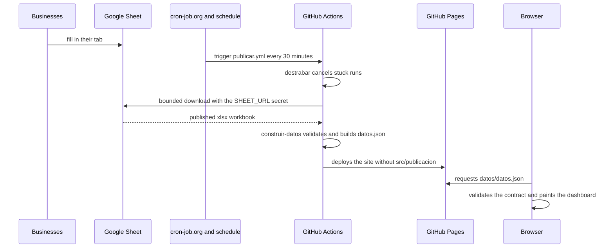
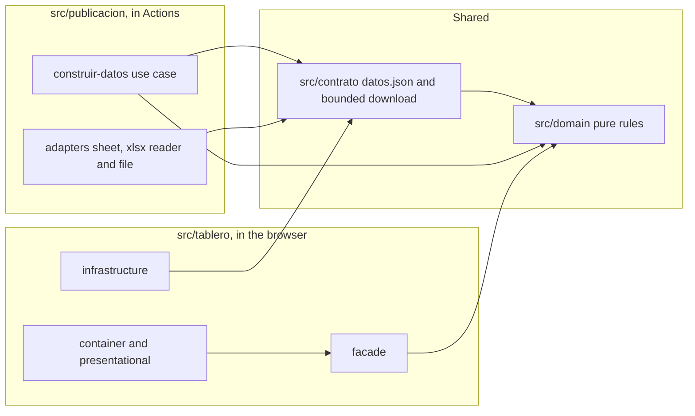

# Visitor Statistics of Patate Canton

[](https://github.com/Alexis-VsCode/turismo-patate/actions/workflows/publicar.yml)
[](https://alexis-vscode.github.io/turismo-patate/)


> [Versión en español](README.md)

Public dashboard for the **Municipal Government of San Cristóbal de Patate (Ecuador)** showing visitor
statistics for the canton's tourism businesses. Each business fills in a shared spreadsheet and the dashboard
refreshes itself, with no servers of its own and no paid licenses.

**Who it is for.** Residents and visitors, who read the open dashboard; the businesses, who only fill in their
own tab of the spreadsheet; and the municipality's tourism team, which links it from its website and uses it to
report. Each one's walkthrough is in the [use cases](docs/casos-de-uso.md) (Spanish).

**[Live demo](https://alexis-vscode.github.io/turismo-patate/)** (the interface is in Spanish),
[Documentation](docs/README.md), [Operations manual](docs/operacion.md) (Spanish)

## Preview

| Light mode | Dark mode |
|---|---|
| [](docs/capturas/escritorio.jpg) | [](docs/capturas/escritorio-oscuro.jpg) |

| Phone, light | Phone, dark | Phone, map |
|---|---|---|
| <a href="docs/capturas/celular.jpg"></a> | <a href="docs/capturas/celular-oscuro.jpg"></a> | <a href="docs/capturas/celular-mapa.jpg"></a> |

## The problem

The municipality needed to publish how many people visit its restaurants, inns and attractions, where they
come from, why they come, and their age and gender. The requirements were:
- **Simple data entry:** each business records its visitors in its own tab of a Google Sheet, using
  dropdowns.
- **Automatic onboarding:** a new tab automatically becomes a new business, with no code changes.
- **Public and free:** the dashboard is linked from the municipal website, works on phones and needs no
  Power BI Pro license.
- **Secure:** the spreadsheet is never exposed; the site publishes only aggregated, validated data.

## Features

- **Indicators:** total visitors with the **change against the same period of the previous year** (up or down arrow).
  Figures animate when filtering.
- **Nationals vs foreigners:** a donut chart with the total in the center, the figures and percentages of each
  group, and a sentence that is worded according to the filters ("... during 2025", "... in March 2025").
- **Charts:**
  - monthly evolution comparing two years, with a trend line;
  - visit reasons with an icon, a bar, a figure and a percentage;
  - distribution by age (0-30, 31-45, 46-60 and 61+) with **Total women** and **Total men**, their figures and percentages;
  - **people with disabilities**: the total, its share of visitors and how many monthly records fall in each range
    (1 to 5, 6 to 10, 11 to 15 and 16 or more; the last one appears only if there are records). It is published only as an aggregate figure and is not crossed with age or gender.
- **Real map** (OpenStreetMap + Leaflet) with three tabs: **Provinces**, **Cities** and **Countries**. Each tab
  changes the bubbles, the "Top" list and the framing, and stays in sync with the Country / City filter.
- **Filters:**
  - **several options at once** for business, country / city / province, reason, age and gender, with type-ahead search;
    year and month stay single-choice;
  - **faceted:** each combo offers only the options that have visitors under the other active filters, not counting its own, and keeps
    the option already chosen. It holds on every path: combos, tags, "Quitar todos", the phone panel, a click on a reason or a chart, and
    a shared link;
  - **origin:** the combos list only the origins that have visitors in the data. The full catalog (about 450
    entries) is used to validate records and place them on the map;
  - options inside one filter are added together and different filters are intersected;
  - **cross-filtering** by clicking the charts, the reasons list and the map;
  - **active-filter tags** above the charts, removed one by one or all at once, which filter the whole dashboard.
- **Shareable link:** the page address reproduces the filters in use (several countries, a year, a reason...); the "Copiar enlace" button copies it and
  whoever opens it sees the same thing. A hand-edited link is validated and anything invalid is dropped.
- **Printing and accessibility:** controls are hidden when printing and each panel goes back to its own cell; there is a skip-to-content link, the
  participation sentence is announced when it changes, and a preview image is provided when the address is shared. Focus returns to its place when
  the tags, the reasons and the combo are repainted; the evolution and age charts are read as images with a summary; with "reduce motion" the
  charts do not animate and the map does not fly.
- **Refresh and freshness:** the site is published every 30 minutes (`PUBLICACION_MINUTOS`). The browser fetches
  on load, with the "Actualizar" button and automatically every 10 minutes (`INTERVALO_AUTO_MS`) while the tab is
  visible. The status bar shows four figures, each with a short explanation beneath it: **Última publicación** ("Datos nuevos cada 30
  minutos", new data every 30 minutes), **Periodo con datos** (the first and last month loaded, e.g. "dic 2024 a sep 2026"), **Establecimientos con
  datos** (businesses with at least one month recorded) and **Registros mensuales** (each one: a month, an origin and a reason). The browser's
  fetch time is no longer shown. A chip tells whether publishing is up to date, delayed or stopped. On medium screens (860 to 1279 px, including a
  phone's desktop mode, around 980 px) the bar is arranged in two rows: chip and buttons on top, the four figures below.
- **Data quality:** invalid rows are never dropped silently; they are listed with their tab and row. An accepted row worth checking
  (hand-written gray columns that contradict the Country, or more than 450000 visitors in one monthly row) is published and leaves a notice.
- **Header and footer:** the header carries the institutional identity and the place. The footer has three columns ("Acerca del dashboard",
  "Privacidad y seguridad" and "Fuentes y licencias"); the GAD band, with its coat of arms, the photo of **Ing. Emerson Hernán Medina Castro,
  Mayor, Administration 2023-2027**, the acknowledgment and the link to the GAD website; and the cards "Contacto del municipio" (Lic. Vanessa
  Lesano Martínez) and "Diseño y desarrollo" (the author), with their photos and their initials as a fallback if a photo does not load. The names
  come from `config.js`. If a social link of the contact is not published yet, its button reads "Pronto" ("soon") and opens a notice with the
  other links. The footer ends with the rights line: the author and year, that the data belongs to the GAD Municipal de San Cristóbal de Patate and
  the canton's establishments, and where the photos come from.
- **Responsive design:** on phones it is a single column, with a floating "Filtros" button that opens a bottom
  sheet; no horizontal scrolling.
- **Light and dark mode:** the site opens in light mode by default, without following the system theme. The moon button switches to dark and that choice is remembered on the device.

## How it works



Publishing has two independent triggers, offset by 15 minutes, and both run the same workflow
(`.github/workflows/publicar.yml`):

| Trigger | When | Purpose |
|---|---|---|
| cron-job.org, via `workflow_dispatch` | Every 30 minutes, at minute 00 and 30 | Primary trigger |
| GitHub `schedule` (`15,45 * * * *`) | Every 30 minutes, at minute 15 and 45 | Backup: if one fails, the other publishes within 15 minutes or less |

The `destrabar` job ("unstick") runs at the start of every run and cancels runs of the workflow that have been
waiting or in progress for more than 25 minutes, so a stuck Pages deployment cannot hold the concurrency lock and
stop everything else; if a run is still active after twice that time (50 minutes), it force-cancels it. On every publication it also calls
`PUT /actions/workflows/{id}/enable`, which keeps the workflow active and resets GitHub's 60-day clock (event `flujo_mantenido`). If it fails,
publishing carries on anyway. The reasoning is in
[decision 009](docs/decisiones/009-publicacion-con-doble-disparador.md) (Spanish).

The spreadsheet URL **never** reaches the code or the site: it lives as an encrypted GitHub secret
(`SHEET_URL`) and only the scheduled job uses it. Details in [docs/configuracion.md](docs/configuracion.md)
(Spanish).

## About the project

This dashboard started from a concrete need of the Municipal Government of Patate: tourism businesses were
already recording their visitors, but that data reached nobody. I set out to publish it without licenses or
servers, and so that anyone at the municipality could add a business just by duplicating a tab.

The decisions that taught me the most:
- **Hiding the source without a backend.** The spreadsheet URL lives as a GitHub Actions secret and the site
  only publishes data that has already been validated.
- **Measuring instead of assuming.** Every figure on the dashboard is reconciled against an independent
  calculation in Python, so a formula error never reaches production.
- **Not claiming what is not verified.** If automatic publishing stops, the site does not
  keep saying "live": a chip says so.
- **Designing for phones first.** Most visits to the municipal website come from a phone.

The alternatives I discarded, and why, are in the [design decisions](docs/decisiones/) (Spanish).

## Observability

**Basic** observability, sized for a static site:
- **Data freshness:** the age of the publication is computed by a pure function and shown in a chip with text
  and color. The thresholds are in `UMBRALES_FRESCURA`: **"Datos al día"** (up to date) through minute 45,
  **"Datos con retraso"** (delayed) from minute 46 to 100, and **"Publicación detenida"** (stopped) from minute 101. They cover one
  30-minute cycle plus Actions delay, and tolerate losing one full cycle before calling publishing stopped.
- **Cadence:** publication every 30 minutes (`PUBLICACION_MINUTOS`) and a browser fetch every 10
  (`INTERVALO_AUTO_MS`).
- **Every publication leaves a trace:** the data builder writes a JSON log line and a summary in the
  **Actions** tab, with counts and durations, never tab names.
- **Unsticking and keep-alive:** the `destrabar` job cancels stuck runs (`destrabar_fin`) and keeps the workflow active (`flujo_mantenido`).
- **If the chip is not green:** first check the repository's **Actions** tab and that the cron-job.org task is
  still active. After 60 days without activity GitHub disables the whole workflow, so cron-job.org's trigger fails too;
  `destrabar` prevents this by re-enabling the workflow on every publication. If it still shows as disabled, re-enable it by hand under **Actions >
  Publicar dashboard > "Enable workflow"**. The step-by-step is in the runbook.
- **Stated limit:** the chip is seen by visitors; alerting whoever operates the site depends on GitHub's
  notifications for a failed workflow.

Details, thresholds and what to do when the chip is not green: [docs/observabilidad.md](docs/observabilidad.md)
(Spanish).

## Stack

| Layer | Technology |
|---|---|
| Interface | HTML, CSS and JavaScript (ES modules), no framework and no build step |
| Charts | Apache ECharts 6.1.0 |
| Map | Leaflet 1.9.4 + OpenStreetMap tiles + geoBoundaries province limits (CC0); geoBoundaries canton catalog (CC BY 3.0 IGO) and mledoze/countries (ODbL) |
| Excel reading | SheetJS 0.20.3, only inside GitHub Actions |
| Publishing | GitHub Actions (triggered by cron-job.org and by `schedule`, every 30 min) + GitHub Pages |
| Testing | `node:test` (Node 22) and an independent Python/openpyxl oracle |

## Architecture

The code has two sides that never import each other: **publishing**, hexagonal, which runs in GitHub Actions, and the **dashboard**
(`tablero`), semi-hexagonal, which runs in the browser. Both use the same domain and the same data contract.



| Layer | Folder | Responsibility |
|---|---|---|
| Domain | [`src/domain/`](src/domain) | Pure rules: visitor normalization, catalog, filters, faceted options, statistics and freshness |
| Contract | [`src/contrato/`](src/contrato) | Versioned `datos.json` format and bounded download, shared by both sides |
| Publishing | [`src/publicacion/`](src/publicacion) | `construir-datos` use case, ports as JSDoc typedefs, adapters (Google sheet, xlsx reader, file) and its configuration |
| Facade | [`src/tablero/application/tablero.facade.js`](src/tablero/application/tablero.facade.js) | State, filters, refresh policy and computed view, no DOM |
| Container | [`src/tablero/application/components/tablero.container.js`](src/tablero/application/components/tablero.container.js) | Connects the page to the facade |
| Presentational and shared components | [`src/tablero/application/components/`](src/tablero/application/components) | Charts, reasons, cards and notices, stateless; combo, filter panel, floating notice and map |
| Dashboard infrastructure | [`src/tablero/infrastructure/`](src/tablero/infrastructure) | Browser configuration and `datos.json` download |
| Shared | [`src/tablero/shared/`](src/tablero/shared) | Texts, formatting and theme logic |
| Composition root | [`src/tablero/main.js`](src/tablero/main.js) | Wires infrastructure, facade and container, and traces the whole flow |
| Publishing entry point | [`tools/construir-datos.mjs`](tools/construir-datos.mjs) | Reads arguments and environment, builds the adapters and calls the use case |

`test/arquitectura.test.mjs` enforces the dependency rule and `test/orden-de-modulos.test.mjs`, the internal order of each module. More in
[docs/arquitectura.md](docs/arquitectura.md) and in [decision 010](docs/decisiones/010-publicacion-hexagonal-y-tablero-semihexagonal.md) (Spanish).

## Security

- **Libraries:** pinned versions with no known CVEs at review time. ECharts 6.1.0 fixes CVE-2026-45249 and
  SheetJS 0.20.3 fixes CVE-2023-30533 and CVE-2024-22363.
- **Integrity (SRI):** every external script and stylesheet carries its `integrity` hash.
- **CSP:** a strict policy that allows each external resource by its exact URL, with `connect-src 'self'`, no inline scripts and no `eval`.
- **Publishing with least privilege:** the workflow grants only `contents: read` and each job declares what it uses. The spreadsheet ID does not
  appear in any file of the repository, and a test enforces it.
- **Spreadsheet content:** treated as untrusted input. It is written with `textContent` or the DOM API,
  protected against prototype pollution, and the download is bounded in size and time.
- **Privacy:** no cookies and no tracking. The only thing stored on the device is the theme choice, and it is
  never sent anywhere.

Details in [docs/seguridad.md](docs/seguridad.md) (Spanish). To report a vulnerability, see
[SECURITY.md](SECURITY.md).

## Tests

They run on every `push` to `main` (a step with `if: github.event_name == 'push'`), and a push with a red test is not published. They do not run on
every scheduled publication. On every pull request, [`ci.yml`](.github/workflows/ci.yml) also runs the builder with the test workbook, the Python
tests of the Excel generator and the oracle, and `npm run oraculo`.

| Folder | What it tests |
|---|---|
| [`test/domain/`](test/domain) | The filter scenarios (totals, series and year-over-year change) reconcile **exactly** with an independent Python oracle ([`tools/oraculo.py`](tools/oraculo.py)) over the test workbooks in `test/fixtures/` (previous and monthly format). Also normalization, filters, faceted options, the shared link, limits and freshness |
| [`test/contrato/`](test/contrato) | The `datos.json` contract: round trip, tampered or older packages, and that the spreadsheet URL never travels |
| [`test/publicacion/`](test/publicacion) | Use case in memory, workbook reader (real-world typos such as `agosoto`, rejected rows with their location, gray-column and suspicious-row notices), hostile HTML, `__proto__`, bounded download and retries |
| [`test/tablero/`](test/tablero) | Facade with a simulated clock, presentational and shared components over a fake DOM, focus on repaint, configuration, formatting, texts, theme, CSP, stylesheet and accessibility |
| [`test/tools/`](test/tools) | Builder entry point, `destrabar`, workflow permissions, oracle, local server and that no file writes a spreadsheet ID |
| [`test/excel/`](test/excel) and [`test/tools/oraculo.test.py`](test/tools/oraculo.test.py) | Excel generator and oracle, in Python |
| [`test/arquitectura.test.mjs`](test/arquitectura.test.mjs) and [`test/orden-de-modulos.test.mjs`](test/orden-de-modulos.test.mjs) | Dependency rule between layers and order of each module |
| [`test/redaccion.test.mjs`](test/redaccion.test.mjs) | No emojis or long dashes in code, tests, tools, styles, workflows and documentation |
| [`test/sin-azul.test.mjs`](test/sin-azul.test.mjs) | No blue color in styles, HTML or code, except the Ecuador flag and the official LinkedIn and Facebook colors |

## Run locally

Requirements: Node 22 or later, and Python 3. The Python dependencies are needed only by the tools that use them:
`openpyxl` for the oracle and the test-data generator, and `xlsxwriter` for the capture workbook generator.

```bash
pip install openpyxl xlsxwriter
```

`package.json` scripts:

| Command | What it does |
|---|---|
| `npm test` | Runs all tests (`node --test "test/**/*.test.mjs"`) |
| `npm run datos` | Generates `datos/datos.json` from the test workbook `test/fixtures/piloto-publicado.xlsx` |
| `npm run oraculo` | Runs the independent Python oracle (`tools/oraculo.py`, needs `openpyxl`) on both test workbooks, rewrites `test/fixtures/esperado.json` and `test/fixtures/esperado-mensual.json`, and runs the reconciliation for both formats |
| `npm run servir` | Starts the cache-free local server |

Python generators, run directly:

| Script | Dependency | Purpose |
|---|---|---|
| `python tools/generar-piloto.py` | `openpyxl` | Fictitious test workbooks |
| `python tools/excel/generar-excel.py --salida <file.xlsx>` | `xlsxwriter` | Capture workbook (`--modo completo` or `fixture`) |
| `python tools/catalogos/generar-catalogos.py` | standard library only | Canton and country catalogs (see `tools/catalogos/LEEME.md`) |
| `python test/excel/plantilla.test.py` | `openpyxl` and `xlsxwriter` | Test of the Excel generator |
| `python test/tools/oraculo.test.py` | `openpyxl` | Test of the oracle |

Common commands:

```bash
npm test
```

```bash
npm run datos
```

```bash
npm run servir
```

Then open `http://127.0.0.1:8765/`. `npm run datos` generates `datos/datos.json` from the test workbook in
[`test/fixtures/`](test/fixtures), and `npm run servir` starts a cache-free server so old modules are never mixed
with new styles. Since automatic publishing does not run locally, the freshness chip turns to
"Publicación detenida" (publishing stopped) 101 minutes after the data was generated; regenerate it with
`npm run datos`.

## Structure

```
    index.html, css/tema.css
    src/
        domain/               pure rules, shared
        contrato/             datos.json contract and bounded download, shared
        publicacion/          use case, ports, adapters and configuration (runs in Actions)
        tablero/              application, infrastructure, shared, main.js (runs in the browser)
    assets/                   logo, header photo, share image (og.jpg) and province limits
        personas/             photos of the people behind the project (footer)
    tools/
        construir-datos.mjs   publishing entry point (runs in Actions)
        destrabar-publicacion.mjs  cancels stuck runs
        oraculo.py, generar-piloto.py, servir.mjs
        excel/                capture workbook generator and Google protection script (proteger-hoja.gs)
        catalogos/            generator and sources of the canton and country catalogs
        vendor/               SheetJS, only for the builder
    test/                     tests per layer (domain, contrato, publicacion, tablero, tools, excel) and fixtures
    docs/                     architecture, use cases, configuration, operations, observability, security,
                              user manual (manual-usuario.md), decisions and screenshots
    .github/
        workflows/            ci.yml and publicar.yml
        dependabot.yml
    LICENSE, CHANGELOG.md, CONTRIBUTING.md, SECURITY.md, THIRD_PARTY_NOTICES.md
```

## Documentation

The documents in `docs/` are written in Spanish, the language of the project's users.

- [Architecture](docs/arquitectura.md)
- [Use cases](docs/casos-de-uso.md)
- [Configuration](docs/configuracion.md)
- [User manual: how to read the dashboard](docs/manual-usuario.md)
- [Operations manual](docs/operacion.md)
- [Observability](docs/observabilidad.md)
- [Security](docs/seguridad.md) and [security policy](SECURITY.md)
- [Design decisions (ADR)](docs/decisiones/), in particular [009, publishing with a double trigger](docs/decisiones/009-publicacion-con-doble-disparador.md) and [010, hexagonal publishing and semi-hexagonal dashboard](docs/decisiones/010-publicacion-hexagonal-y-tablero-semihexagonal.md)
- [Contributing guide](CONTRIBUTING.md)
- [Changelog](CHANGELOG.md)

## People behind the project

| Person | Role |
|---|---|
| **Ing. Kevin Alexis Barrera Llerena** | Author. Design, development, publishing and monitoring (observability) of the dashboard. |
| **Lic. Vanessa Lesano Martínez** | Bachelor in Tourism. Contact and support at the Municipal Government of San Cristóbal de Patate. |
| **Ing. Emerson Hernán Medina Castro** | Mayor of San Cristóbal de Patate, Administration 2023-2027. His administration supports the dashboard. |

**Ing. Kevin Alexis Barrera Llerena**, Software Engineer.

[](https://www.linkedin.com/in/alexisbarreradesarrolador/)
[](https://www.facebook.com/alexis.barrerallerena1804)
[](https://www.tiktok.com/@mancogamesam)

**Lic. Vanessa Lesano Martínez**, municipality contact.

[](https://www.facebook.com/vane.lesano.martinez)
[](https://www.tiktok.com/@vanelesano)


## Acknowledgments

To the **Municipal Government of San Cristóbal de Patate**, under the administration of **Ing. Emerson Hernán Medina Castro** (2023-2027),
and to **Lic. Vanessa Lesano Martínez**, for providing the information from the tourism establishments and supporting the development of this
dashboard.

## License

© 2026 Kevin Alexis Barrera Llerena. **All rights reserved.** The code is published for reference and
portfolio purposes; reuse requires the author's written permission (see [LICENSE](LICENSE)). Third-party
components keep their own licenses ([THIRD_PARTY_NOTICES.md](THIRD_PARTY_NOTICES.md)). The data and the logo belong to the Municipal Government of San Cristóbal de Patate.

The site publishes the real data the municipality loads into its spreadsheet (`DATOS_DE_PRUEBA` is `false`). The
workbooks in [`test/fixtures/`](test/fixtures) and those generated by [`tools/generar-piloto.py`](tools/generar-piloto.py)
are **fictitious** and serve only for tests and local runs.
