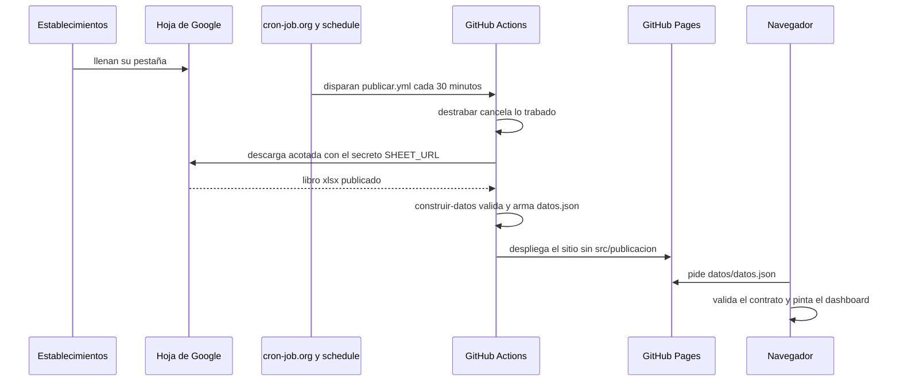
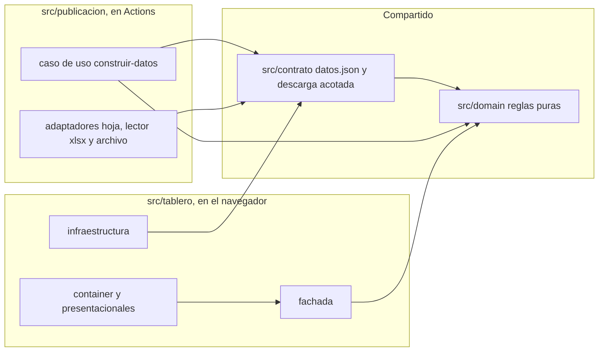

# Estadísticas de Visitantes del Cantón Patate

[](https://github.com/Alexis-VsCode/turismo-patate/actions/workflows/publicar.yml)
[](https://alexis-vscode.github.io/turismo-patate/)


> [English version](README.en.md)

Dashboard público del **GAD Municipal de San Cristóbal de Patate (Ecuador)** con las estadísticas de visitantes
de los establecimientos turísticos del cantón. Los establecimientos llenan una hoja de cálculo compartida y el
dashboard se actualiza solo, sin servidores propios ni licencias.

**Para quién es.** Para la ciudadanía y los visitantes, que consultan el dashboard abierto; para los
establecimientos, que solo llenan su pestaña de la hoja; y para el equipo de turismo del municipio, que lo enlaza
desde su web y lo usa para informar. Los recorridos de cada uno están en [casos de uso](docs/casos-de-uso.md).

**[Ver demo en vivo](https://alexis-vscode.github.io/turismo-patate/)**, [Documentación](docs/README.md),
[Manual de operación](docs/operacion.md)

## Vista previa

| Modo claro | Modo oscuro |
|---|---|
| [](docs/capturas/escritorio.jpg) | [](docs/capturas/escritorio-oscuro.jpg) |

| Celular, claro | Celular, oscuro | Celular, mapa |
|---|---|---|
| <a href="docs/capturas/celular.jpg"></a> | <a href="docs/capturas/celular-oscuro.jpg"></a> | <a href="docs/capturas/celular-mapa.jpg"></a> |

## El problema que resuelve

El municipio necesitaba publicar cuántas personas visitan sus restaurantes, hosterías y atractivos, de dónde
vienen, por qué motivo, y con qué edad y género. Las condiciones eran:
- **Captura simple:** cada establecimiento anota sus visitantes en su propia pestaña de una Google Sheet, con
  desplegables.
- **Alta automática:** una pestaña nueva se convierte en un establecimiento nuevo sin tocar código.
- **Público y gratuito:** el dashboard se enlaza desde la web del municipio, abre en el celular y no depende de
  licencias como Power BI Pro.
- **Seguro:** la hoja no se expone. El sitio solo publica datos agregados y validados.

## Funcionalidades

- **Indicadores:** total de visitantes con su **variación contra el mismo período del año anterior**
  (flecha hacia arriba o hacia abajo). Las cifras se animan al filtrar.
- **Participación de nacionales y extranjeros:** una dona con el total al centro, las cifras y porcentajes de
  cada grupo, y una frase que se redacta según los filtros («... durante el 2025», «... en marzo de 2025»).
- **Gráficos:**
  - evolución mensual comparando dos años, con línea de tendencia;
  - motivos de visita con ícono, barra, cifra y porcentaje;
  - distribución por edad (0-30, 31-45, 46-60 y 61+) con **Total mujeres** y **Total hombres**, sus cifras y porcentajes;
  - **personas con discapacidad**: la cifra, su porcentaje sobre los visitantes y cuántos registros mensuales caen en cada
    rango (1 a 5, 6 a 10, 11 a 15 y 16 o más; este último aparece solo si hay registros). Se publica solo como cifra agregada y no se cruza con la edad ni con el género.
- **Mapa real** (OpenStreetMap + Leaflet) con tres pestañas: **Provincias**, **Ciudades** y **Países**. Cada
  pestaña cambia las burbujas, el «Top» y el encuadre, y se sincroniza con el filtro País / Ciudad.
- **Filtros:**
  - **varias opciones a la vez** en establecimiento, país / ciudad / provincia, motivo, edad y género, con búsqueda al escribir;
    año y mes son de una sola opción;
  - **facetados:** cada combo ofrece solo las opciones que tienen visitantes bajo los demás filtros activos, sin contar el suyo, y conserva
    la opción ya elegida. Vale por todos los caminos: combos, etiquetas, «Quitar todos», panel del celular, clic en un motivo o un gráfico y
    enlace compartido;
  - **procedencia:** los combos muestran solo los orígenes que tienen visitantes en los datos. El catálogo completo
    (unas 450 entradas) se usa para validar los registros y ubicarlos en el mapa;
  - dentro de un filtro las opciones se suman y entre filtros se cruzan;
  - **filtrado cruzado** con clic en los gráficos, en la lista de motivos y en el mapa;
  - **etiquetas de filtros activos** sobre los gráficos, que se quitan una por una o todas a la vez, y que filtran todo el dashboard.
- **Enlace compartible:** la dirección de la página reproduce los filtros puestos (varios países, un año, un motivo...); el botón «Copiar enlace» la copia
  y quien la abre ve lo mismo. Un enlace editado a mano se valida y lo que no sirve se descarta.
- **Impresión y accesibilidad:** al imprimir se ocultan los controles y cada panel vuelve a su celda; hay un enlace para saltar al contenido, anuncio de los
  cambios de la frase de participación y vista previa al compartir la dirección en redes. El foco vuelve a su lugar al repintar las etiquetas, los motivos y
  el combo; los gráficos de evolución y de edad se leen como imágenes con un resumen; con «reducir movimiento» los gráficos no se animan y el mapa no vuela.
- **Actualización y frescura:** el sitio se publica cada 30 minutos (`PUBLICACION_MINUTOS`). El navegador consulta
  al entrar, con el botón «Actualizar» y de forma automática cada 10 minutos (`INTERVALO_AUTO_MS`) mientras la
  pestaña está visible. La barra de estado muestra cuatro datos, cada uno con su explicación debajo: **Última publicación** («Datos nuevos cada 30
  minutos»), **Periodo con datos** («Primer y último mes cargados», p. ej. «dic 2024 a sep 2026»), **Establecimientos con datos** («Con al
  menos un mes registrado») y **Registros mensuales** («Cada uno: un mes, un origen y un motivo»). La hora de consulta del navegador no se
  muestra. Un chip indica si la publicación está al día, retrasada o detenida. En pantallas medianas (de 860 a 1279 px, incluido el modo
  escritorio del celular, de unos 980 px) la barra se ordena en dos filas: chip y botones arriba, los cuatro datos debajo.
- **Calidad de datos:** las filas inválidas no se descartan en silencio; se listan con su pestaña y su fila. Una fila aceptada que conviene revisar
  (columnas grises escritas a mano que contradicen el País, o más de 450000 visitantes en una fila mensual) se publica y deja un aviso.
- **Encabezado y pie:** el encabezado lleva la identidad institucional y el lugar. El pie tiene tres columnas («Acerca del dashboard»,
  «Privacidad y seguridad» y «Fuentes y licencias»); la franja del GAD, con su escudo, la foto del **Ing. Emerson Hernán Medina Castro, Alcalde,
  Administración 2023-2027**, el agradecimiento y el enlace al sitio del GAD; y las tarjetas «Contacto del municipio» (Lic. Vanessa Lesano
  Martínez) y «Diseño y desarrollo» (el autor), con sus fotos y sus iniciales como respaldo si la foto no carga. Los nombres salen de `config.js`.
  Si el enlace de una red del contacto aún no está publicado, su botón dice «Pronto» y abre un aviso con los demás enlaces. Al final lleva la
  línea de derechos: el autor y el año, que los datos son del GAD Municipal de San Cristóbal de Patate y de los establecimientos del cantón, y de
  dónde salen las fotos.
- **Diseño adaptable:** en el celular se ve en una columna, con un botón flotante «Filtros» que abre un panel
  desde abajo; sin scroll horizontal.
- **Modo claro y oscuro:** el sitio abre en modo claro por defecto, sin seguir el tema del sistema. El botón de la luna cambia a oscuro y esa elección se recuerda en el dispositivo.

## Cómo funciona



La publicación tiene dos disparadores independientes, desfasados 15 minutos, y ambos ejecutan el mismo flujo
(`.github/workflows/publicar.yml`):

| Disparador | Cuándo | Para qué |
|---|---|---|
| cron-job.org, por `workflow_dispatch` | Cada 30 minutos, en el minuto 00 y 30 | Disparador principal |
| `schedule` de GitHub (`15,45 * * * *`) | Cada 30 minutos, en el minuto 15 y 45 | Refuerzo: si uno falla, el otro publica en 15 minutos o menos |

El job `destrabar` corre al inicio de cada ejecución y cancela las ejecuciones del flujo que llevan más de 25
minutos en espera o en curso, para que un despliegue de Pages atascado no retenga el candado de concurrencia y
detenga todo lo demás; si una ejecución sigue activa pasado el doble (50 minutos), fuerza su cancelación. Además llama en cada publicación a
`PUT /actions/workflows/{id}/enable`, que mantiene el flujo activo y reinicia el plazo de 60 días de GitHub (evento `flujo_mantenido`). Si falla,
la publicación sigue igual. La razón de este diseño está en la
[decisión 009](docs/decisiones/009-publicacion-con-doble-disparador.md).

La URL de la hoja **nunca** llega al código ni al sitio: vive como secreto cifrado de GitHub (`SHEET_URL`), y solo
la usa la tarea automática. Detalle en [docs/configuracion.md](docs/configuracion.md).

## Sobre el proyecto

Este dashboard nació de una necesidad concreta del GAD Municipal de Patate: los establecimientos turísticos ya
anotaban a sus visitantes, pero esos datos no llegaban a nadie. Me propuse que publicarlos no costara licencias
ni servidores, y que cualquier persona del municipio pudiera sumar un establecimiento con solo duplicar una
pestaña.

Las decisiones que más me enseñaron:
- **Ocultar la fuente sin un backend.** La URL de la hoja vive como secreto de GitHub Actions y el sitio solo
  publica datos ya validados.
- **Medir en lugar de suponer.** Cada cifra del dashboard se concilia contra un cálculo independiente en Python,
  así un error de fórmula no llega a producción.
- **No afirmar lo que no se verifica.** Si la publicación automática se detiene, el sitio no
  sigue diciendo «en vivo»: un chip lo indica.
- **Diseñar para el celular primero.** La mayoría de visitas a la web municipal llega desde el teléfono.

Las alternativas que descarté, y por qué, están en las [decisiones de diseño](docs/decisiones/).

## Observabilidad

Observabilidad **básica**, pensada para un sitio estático:
- **Frescura de los datos:** la edad de la publicación se calcula con una función pura y se muestra en un chip
  con texto y color. Los umbrales están en `UMBRALES_FRESCURA`: **«Datos al día»** hasta el minuto 45,
  **«Datos con retraso»** desde el 46 hasta el 100 y **«Publicación detenida»** desde el 101. Cubren un ciclo de 30 minutos más
  la demora de Actions, y toleran perder un ciclo entero antes de dar la publicación por detenida.
- **Cadencia:** publicación cada 30 minutos (`PUBLICACION_MINUTOS`) y consulta del navegador cada 10
  (`INTERVALO_AUTO_MS`).
- **Cada publicación deja rastro:** el constructor de datos escribe una línea de log JSON y un resumen en la
  pestaña **Actions**, con cuentas y duraciones, nunca nombres de pestañas.
- **Destrabar y mantener:** el job `destrabar` cancela las ejecuciones atascadas (`destrabar_fin`) y mantiene activo el flujo (`flujo_mantenido`).
- **Si el chip no está en verde:** primero se revisa la pestaña **Actions** del repositorio y que la tarea de
  cron-job.org siga activa. Tras 60 días sin actividad GitHub desactiva el flujo entero, y entonces también falla el disparo de cron-job.org;
  `destrabar` lo evita reactivando el flujo en cada publicación. Si aun así aparece desactivado, se reactiva a mano en **Actions > Publicar
  dashboard > «Enable workflow»**. El paso a paso está en el runbook.
- **Límite declarado:** el chip lo ven los visitantes; avisar a quien opera depende de las notificaciones de
  GitHub por un workflow fallido.

Detalle, umbrales y qué hacer cuando el chip no está en verde: [docs/observabilidad.md](docs/observabilidad.md).

## Stack

| Capa | Tecnología |
|---|---|
| Interfaz | HTML, CSS y JavaScript (módulos ES), sin framework ni paso de build |
| Gráficos | Apache ECharts 6.1.0 |
| Mapa | Leaflet 1.9.4 + teselas OpenStreetMap + límites provinciales geoBoundaries (CC0); catálogo de cantones geoBoundaries (CC BY 3.0 IGO) y de países mledoze/countries (ODbL) |
| Lectura del Excel | SheetJS 0.20.3, solo dentro de GitHub Actions |
| Publicación | GitHub Actions (disparado por cron-job.org y por `schedule`, cada 30 min) + GitHub Pages |
| Pruebas | `node:test` (Node 22) y oráculo independiente en Python/openpyxl |

## Arquitectura

El código tiene dos lados que nunca se importan entre sí: la **publicación**, hexagonal, que corre en GitHub Actions, y el **tablero**,
semihexagonal, que corre en el navegador. Los dos usan el mismo dominio y el mismo contrato de datos.



| Capa | Carpeta | Responsabilidad |
|---|---|---|
| Dominio | [`src/domain/`](src/domain) | Reglas puras: normalización de visitantes, catálogo, filtros, opciones facetadas, estadísticas y frescura |
| Contrato | [`src/contrato/`](src/contrato) | Formato versionado de `datos.json` y descarga acotada, compartidos por los dos lados |
| Publicación | [`src/publicacion/`](src/publicacion) | Caso de uso `construir-datos`, puertos como typedef de JSDoc, adaptadores (hoja de Google, lector xlsx, archivo) y su configuración |
| Fachada | [`src/tablero/application/tablero.facade.js`](src/tablero/application/tablero.facade.js) | Estado, filtros, política de actualización y vista calculada, sin DOM |
| Container | [`src/tablero/application/components/tablero.container.js`](src/tablero/application/components/tablero.container.js) | Conecta la página con la fachada |
| Presentacionales y compartidos | [`src/tablero/application/components/`](src/tablero/application/components) | Gráficos, motivos, tarjetas y avisos, sin estado; combo, panel de filtros, aviso flotante y mapa |
| Infraestructura del tablero | [`src/tablero/infrastructure/`](src/tablero/infrastructure) | Configuración del navegador y descarga de `datos.json` |
| Shared | [`src/tablero/shared/`](src/tablero/shared) | Textos, formato y lógica del tema |
| Raíz de composición | [`src/tablero/main.js`](src/tablero/main.js) | Une infraestructura, fachada y container, y traza el flujo completo |
| Punto de entrada de la publicación | [`tools/construir-datos.mjs`](tools/construir-datos.mjs) | Lee argumentos y entorno, arma los adaptadores y llama al caso de uso |

`test/arquitectura.test.mjs` vigila la regla de dependencias y `test/orden-de-modulos.test.mjs`, el orden interno de cada módulo. Más en
[docs/arquitectura.md](docs/arquitectura.md) y en la [decisión 010](docs/decisiones/010-publicacion-hexagonal-y-tablero-semihexagonal.md).

## Seguridad

- **Librerías:** versiones fijas y sin CVE conocidos a la fecha de revisión. ECharts 6.1.0 corrige
  CVE-2026-45249 y SheetJS 0.20.3 corrige CVE-2023-30533 y CVE-2024-22363.
- **Integridad (SRI):** cada script y hoja de estilos externos llevan su hash `integrity`.
- **CSP:** una política estricta que permite cada recurso externo por su URL exacta, con `connect-src 'self'`, sin scripts en línea ni `eval`.
- **Publicación con permisos mínimos:** el flujo solo da `contents: read` y cada job declara lo que usa. El ID de la hoja no aparece en ningún
  archivo del repositorio, y una prueba lo vigila.
- **Contenido de la hoja:** se trata como entrada no confiable. Se escribe con `textContent` o con la API del
  DOM, se protege contra la contaminación de prototipos y la descarga tiene límites de tamaño y tiempo.
- **Privacidad:** sin cookies ni rastreo. Solo se guarda en el dispositivo la elección de tema, y no se envía a
  ningún sitio.

Detalle en [docs/seguridad.md](docs/seguridad.md). Para reportar una vulnerabilidad, ver [SECURITY.md](SECURITY.md).

## Pruebas

Corren en cada `push` a `main` (paso con `if: github.event_name == 'push'`), y un `push` con una prueba en rojo no se publica. No corren en cada
publicación programada. En cada pull request, [`ci.yml`](.github/workflows/ci.yml) corre además el constructor con el libro de prueba, las pruebas
de Python del Excel y del oráculo, y `npm run oraculo`.

| Carpeta | Qué prueba |
|---|---|
| [`test/domain/`](test/domain) | Los escenarios de filtros (totales, series y variación interanual) concilian **exactamente** con un oráculo independiente en Python ([`tools/oraculo.py`](tools/oraculo.py)) sobre los libros de prueba de `test/fixtures/` (formato anterior y mensual). También normalización, filtros, opciones facetadas, enlace, límites y frescura |
| [`test/contrato/`](test/contrato) | Contrato de `datos.json`: ida y vuelta, paquetes alterados o anteriores, y que la URL de la hoja no viaje |
| [`test/publicacion/`](test/publicacion) | Caso de uso en memoria, lector del libro (errores reales como `agosoto`, rechazos con ubicación, avisos de columnas grises y de fila sospechosa), HTML hostil, `__proto__`, descarga acotada y reintentos |
| [`test/tablero/`](test/tablero) | Fachada con reloj simulado, presentacionales y compartidos sobre un DOM falso, foco al repintar, configuración, formato, textos, tema, CSP, hoja de estilos y accesibilidad |
| [`test/tools/`](test/tools) | Punto de entrada del constructor, `destrabar`, permisos de los flujos, oráculo, servidor local y que nadie escriba el ID de una hoja |
| [`test/excel/`](test/excel) y [`test/tools/oraculo.test.py`](test/tools/oraculo.test.py) | Generador del Excel y oráculo, en Python |
| [`test/arquitectura.test.mjs`](test/arquitectura.test.mjs) y [`test/orden-de-modulos.test.mjs`](test/orden-de-modulos.test.mjs) | Regla de dependencias entre capas y orden de cada módulo |
| [`test/redaccion.test.mjs`](test/redaccion.test.mjs) | Sin emojis ni guiones largos en código, pruebas, herramientas, estilos, flujos y documentación |
| [`test/sin-azul.test.mjs`](test/sin-azul.test.mjs) | Ningún color azul en estilos, HTML ni código, salvo la bandera de Ecuador y los colores oficiales de LinkedIn y Facebook |

## Ejecutar en local

Requisitos: Node 22 o superior y Python 3. Las dependencias de Python solo hacen falta para las herramientas que las usan:
`openpyxl` para el oráculo y el generador de datos de prueba, y `xlsxwriter` para el generador del libro de captura.

```bash
pip install openpyxl xlsxwriter
```

Scripts de `package.json`:

| Comando | Qué hace |
|---|---|
| `npm test` | Corre todas las pruebas (`node --test "test/**/*.test.mjs"`) |
| `npm run datos` | Genera `datos/datos.json` desde el libro de prueba `test/fixtures/piloto-publicado.xlsx` |
| `npm run oraculo` | Corre el oráculo independiente en Python (`tools/oraculo.py`, requiere `openpyxl`) con los dos libros de prueba, reescribe `test/fixtures/esperado.json` y `test/fixtures/esperado-mensual.json` y corre la conciliación de los dos formatos |
| `npm run servir` | Levanta el servidor local sin caché |

Generadores en Python, que se ejecutan directamente:

| Script | Dependencia | Para qué |
|---|---|---|
| `python tools/generar-piloto.py` | `openpyxl` | Libros ficticios de prueba |
| `python tools/excel/generar-excel.py --salida <archivo.xlsx>` | `xlsxwriter` | Libro de captura (`--modo completo` o `fixture`) |
| `python tools/catalogos/generar-catalogos.py` | solo biblioteca estándar | Catálogos de cantones y países (ver `tools/catalogos/LEEME.md`) |
| `python test/excel/plantilla.test.py` | `openpyxl` y `xlsxwriter` | Prueba del generador del Excel |
| `python test/tools/oraculo.test.py` | `openpyxl` | Prueba del oráculo |

Comandos habituales:

```bash
npm test
```

```bash
npm run datos
```

```bash
npm run servir
```

Luego se abre `http://127.0.0.1:8765/`. `npm run datos` genera `datos/datos.json` a partir del libro de prueba de
[`test/fixtures/`](test/fixtures), y `npm run servir` levanta un servidor sin caché, para no mezclar módulos
viejos con estilos nuevos. Como en local no corre la publicación automática, el chip de frescura pasa a
«Publicación detenida» a los 101 minutos de haber generado los datos; se vuelve a generar con `npm run datos`.

## Estructura

```
    index.html, css/tema.css
    src/
        domain/               reglas puras, compartidas
        contrato/             contrato de datos.json y descarga acotada, compartidos
        publicacion/          caso de uso, puertos, adaptadores y configuración (corre en Actions)
        tablero/              application, infrastructure, shared, main.js (corre en el navegador)
    assets/                   logo, foto de cabecera, imagen para compartir (og.jpg) y límites provinciales
        personas/             fotos de las personas del proyecto (pie de página)
    tools/
        construir-datos.mjs   punto de entrada de la publicación (corre en Actions)
        destrabar-publicacion.mjs  cancela ejecuciones atascadas
        oraculo.py, generar-piloto.py, servir.mjs
        excel/                generador del libro de captura y script de protección de Google (proteger-hoja.gs)
        catalogos/            generador y fuentes de los catálogos de cantones y países
        vendor/               SheetJS, solo para el constructor
    test/                     pruebas por capa (domain, contrato, publicacion, tablero, tools, excel) y fixtures
    docs/                     arquitectura, casos de uso, configuración, operación, observabilidad, seguridad,
                              manual de usuario (manual-usuario.md), decisiones y capturas
    .github/
        workflows/            ci.yml y publicar.yml
        dependabot.yml
    LICENSE, CHANGELOG.md, CONTRIBUTING.md, SECURITY.md, THIRD_PARTY_NOTICES.md
```

## Documentación

- [Arquitectura](docs/arquitectura.md)
- [Casos de uso](docs/casos-de-uso.md)
- [Configuración: dónde se configura cada cosa y cómo se oculta la URL de la hoja](docs/configuracion.md)
- [Manual de usuario: cómo leer el dashboard](docs/manual-usuario.md)
- [Manual de operación](docs/operacion.md)
- [Observabilidad](docs/observabilidad.md)
- [Seguridad](docs/seguridad.md) y [política de seguridad](SECURITY.md)
- [Decisiones de diseño (ADR)](docs/decisiones/), en particular la [009, publicación con doble disparador](docs/decisiones/009-publicacion-con-doble-disparador.md) y la [010, publicación hexagonal y tablero semihexagonal](docs/decisiones/010-publicacion-hexagonal-y-tablero-semihexagonal.md)
- [Guía de contribución](CONTRIBUTING.md)
- [Registro de cambios](CHANGELOG.md)

## Personas del proyecto

| Persona | Rol |
|---|---|
| **Ing. Kevin Alexis Barrera Llerena** | Autor. Diseño, desarrollo, publicación y monitoreo (observabilidad) del dashboard. |
| **Lic. Vanessa Lesano Martínez** | Licenciada en Turismo. Contacto y apoyo del GAD Municipal de San Cristóbal de Patate. |
| **Ing. Emerson Hernán Medina Castro** | Alcalde de San Cristóbal de Patate, Administración 2023-2027. Su administración respalda el dashboard. |

**Ing. Kevin Alexis Barrera Llerena**, Ingeniero de Software.

[](https://www.linkedin.com/in/alexisbarreradesarrolador/)
[](https://www.facebook.com/alexis.barrerallerena1804)
[](https://www.tiktok.com/@mancogamesam)

**Lic. Vanessa Lesano Martínez**, contacto del municipio.

[](https://www.facebook.com/vane.lesano.martinez)
[](https://www.tiktok.com/@vanelesano)


## Agradecimientos

Al **GAD Municipal de San Cristóbal de Patate**, administración del **Ing. Emerson Hernán Medina Castro** (2023-2027), y a la
**Lic. Vanessa Lesano Martínez**, por facilitar la información de los establecimientos turísticos y respaldar el desarrollo de este dashboard.

## Licencia

© 2026 Kevin Alexis Barrera Llerena. **Todos los derechos reservados.** El código se publica para consulta y
portafolio; su reutilización requiere autorización escrita del autor (ver [LICENSE](LICENSE)). Los componentes
de terceros conservan sus licencias ([THIRD_PARTY_NOTICES.md](THIRD_PARTY_NOTICES.md)). Los datos y el logo pertenecen al GAD Municipal de San Cristóbal de Patate.

El sitio publica los datos reales que el municipio carga en su hoja (`DATOS_DE_PRUEBA` está en `false`). Los libros de
[`test/fixtures/`](test/fixtures) y los que genera [`tools/generar-piloto.py`](tools/generar-piloto.py) son **ficticios** y
solo sirven para las pruebas y para ejecutar en local.
