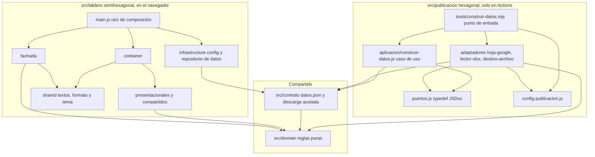
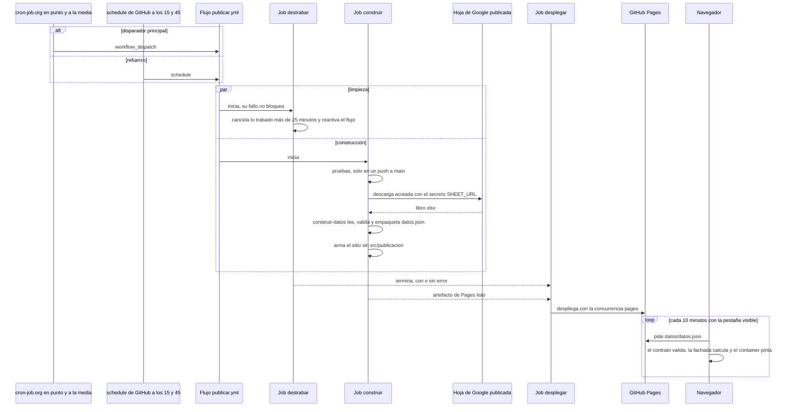

# Arquitectura

## Visión general

Sitio estático sin framework ni paso de build. El código de `src/` tiene **dos lados** que nunca se importan entre sí y **dos piezas
compartidas**:

- **Publicación** (`src/publicacion/`), en forma hexagonal: corre solo en GitHub Actions, lee la hoja y escribe `datos.json`.
- **Tablero** (`src/tablero/`), en forma semihexagonal: corre en el navegador, lee `datos.json` y pinta el dashboard.
- **Dominio** (`src/domain/`): reglas puras del negocio, sin DOM, red ni librerías.
- **Contrato** (`src/contrato/`): formato de `datos.json` y descarga acotada, que usan los dos lados.

La decisión y sus alternativas están en la [ADR 010](decisiones/010-publicacion-hexagonal-y-tablero-semihexagonal.md), que amplía la
[ADR 004](decisiones/004-capas-semihexagonales.md).

Las flechas son imports. No hay ninguna entre Publicacion y Tablero.

## Capas

| Capa | Archivos | Qué hace | Qué no hace |
|---|---|---|---|
| **Dominio** | `src/domain/catalogo.js`, `visitante.js`, `filtros.js`, `enlace.js`, `estadisticas.js`, `discapacidad.js`, `frescura.js`, `texto.js` | Normaliza filas, reconoce encabezados, guarda los límites de validación, filtra, calcula KPI, series y opciones facetadas, clasifica la frescura y limpia texto | No conoce el DOM, la red, Node ni las librerías |
| **Contrato** | `src/contrato/contrato-datos.js`, `descarga-acotada.js` | Empaqueta y desempaqueta `datos.json` con versión y validación; descarga con tope de tiempo y tamaño y códigos de error estables (`ErrorDescarga`) | No reintenta: los reintentos son política de la publicación |
| **Publicación, caso de uso** | `src/publicacion/aplicacion/construir-datos.js` | Pide el libro a la fuente, lo lee, exige un mínimo de establecimientos, lo empaqueta y lo entrega al destino; si algo falla, no escribe | No sabe de Google, de SheetJS ni del disco: recibe sus puertos como argumentos |
| **Publicación, puertos** | `src/publicacion/puertos.js` | Declara `FuenteHoja`, `LectorLibro` y `DestinoPublicacion` como `@typedef` de JSDoc | No tiene código: ni clases ni funciones |
| **Publicación, adaptadores** | `src/publicacion/adaptadores/hoja-google.js`, `lector-xlsx.js`, `destino-archivo.js` | Descarga la hoja con reintentos, lee el libro con SheetJS en modo restrictivo y escribe `datos.json` de forma atómica | Son los únicos de `src/` que cargan `node:*` |
| **Publicación, configuración** | `src/publicacion/config-publicacion.js` | Topes de la descarga y de la lectura, pestaña de catálogos, país local, mínimo de establecimientos y tope de sensatez de una fila | No importa nada |
| **Tablero, fachada** | `src/tablero/application/tablero.facade.js` | Estado de datos y filtros, opciones facetadas de los combos, pestaña del mapa, política de actualización (reuso, recarga al cambiar de establecimiento, consulta automática), frescura, vista calculada y eventos | No toca el DOM ni la red: recibe la descarga, el reloj y la visibilidad inyectados |
| **Tablero, container** | `src/tablero/application/components/tablero.container.js` | Traduce eventos del DOM y de los gráficos en acciones de la fachada, pinta su vista y programa la revisión periódica | No calcula ni descarga: los datos los pide la fachada y los límites del mapa llegan por una función inyectada |
| **Tablero, presentacionales** | `src/tablero/application/components/presentational/*.js` | Pintan KPI, gráficos, motivos, discapacidad, barra de estado, chip de frescura, chips de filtros, problemas de carga y personas del pie | No guardan estado ni acceden a datos |
| **Tablero, compartidos** | `src/tablero/application/components/compartidos/*.js` | Combo de varias opciones con búsqueda accesible, llenado seguro de `<select>`, panel de filtros deslizable, selector de tema, aviso flotante y mapa de Leaflet | Guardan solo el estado propio del control (lo abierto, lo enfocado, las capas de Leaflet); qué pintar lo decide la fachada |
| **Tablero, infraestructura** | `src/tablero/infrastructure/config.js`, `repositorio-datos.js` | Configuración del navegador y descarga de `datos.json` y de los límites del mapa | No tiene reglas de negocio |
| **Tablero, shared** | `src/tablero/shared/textos.es.js`, `formato.js`, `tema.js`, `tema-inicial.js` | Textos visibles, formato de números y fechas, y lógica del tema. `tema-inicial.js` es un script clásico que corre antes del primer pintado ([ADR 005](decisiones/005-tema-y-excepciones-de-color.md)) | No importa fuera de shared |
| **Tablero, raíz** | `src/tablero/main.js` | Une infraestructura, fachada y container | Ninguna |

El contacto del municipio sigue el mismo camino que el resto de la interfaz: el container le pasa `CONTACTO_MUNICIPIO` a
`contacto.presentational.js`, que dibuja un enlace por cada red con dirección válida y un botón «Pronto» por cada red sin dirección. Ese
botón no abre nada por sí mismo: avisa al container, que arma el contenido con los enlaces disponibles y pide a `aviso.js` que lo muestre.
Así un presentacional no importa a un compartido.

## Regla de dependencias

La vigila [`test/arquitectura.test.mjs`](../test/arquitectura.test.mjs), que lee los `import`, `export ... from` e `import()` de cada
módulo de `src/`:

| Capa | Puede importar |
|---|---|
| Dominio | dominio |
| Contrato | dominio, contrato |
| Publicación, caso de uso | dominio, contrato, puertos |
| Publicación, adaptadores | dominio, contrato, puertos, configuración de la publicación |
| Publicación, puertos y configuración | nada |
| Tablero, infraestructura | dominio, contrato, infraestructura |
| Tablero, shared | shared |
| Tablero, fachada | dominio, shared |
| Tablero, presentacionales y compartidos | dominio, shared |
| Tablero, container | shared, presentacionales, compartidos |
| Tablero, raíz | todas las del tablero, dominio y contrato |

Además la prueba falla si un archivo no cae en ninguna capa, si la publicación y el tablero se importan entre sí, si alguien que no es
adaptador carga `node:*`, si se importa un paquete externo, si `puertos.js` tiene código, si `tools/construir-datos.mjs` importa algo
fuera de `src/publicacion/` o si aparece un ciclo de dependencias.

## Orden de cada módulo

Lo vigila [`test/orden-de-modulos.test.mjs`](../test/orden-de-modulos.test.mjs). El detalle está en
[`CONTRIBUTING.md`](../CONTRIBUTING.md#6-estilo-de-código-y-de-texto):

1. Cabecera JSDoc con `@file` (el nombre del archivo), `@description` y `@author`.
2. Imports en orden: `node:*`, dominio, contrato y después las capas propias. Ningún import después del primer código.
3. Constantes, API pública y ayudantes privados, en ese orden.
4. Rótulos `// ===== RÓTULO =====` de una lista cerrada y comentarios internos solo como `// Paso N:`, en orden y sin repetirse.

## Publicación

La arranca uno de dos disparadores independientes, descritos en la [ADR 009](decisiones/009-publicacion-con-doble-disparador.md). El
flujo [`publicar.yml`](../.github/workflows/publicar.yml) tiene tres jobs: `destrabar` y `construir` corren en paralelo y `desplegar`
espera a los dos. Cada job declara solo los permisos que usa: `destrabar` tiene `actions: write`, `construir` tiene `contents: read` y
`pages: read`, y `desplegar` tiene `pages: write` e `id-token: write`.

La concurrencia `pages` está solo en `desplegar`. Si estuviera a nivel de flujo, un despliegue atascado retendría el grupo y cancelaría
todas las ejecuciones siguientes, incluida la que debe limpiarlo.

1. **Punto de entrada.** [`tools/construir-datos.mjs`](../tools/construir-datos.mjs) valida que `SHEET_URL` sea la de una hoja publicada
   en xlsx, arma los tres adaptadores con [`config-publicacion.js`](../src/publicacion/config-publicacion.js) y llama al caso de uso.
   Con `--desde-archivo` lee un libro local en lugar de la hoja (así funciona `npm run datos`).
2. **Fuente.** [`hoja-google.js`](../src/publicacion/adaptadores/hoja-google.js) descarga con
   [`descarga-acotada.js`](../src/contrato/descarga-acotada.js) (120 s y 50 MB como máximo) y repite ante un corte de red, un 429 o un
   5xx: hasta 3 intentos en total, con esperas de 2 s y 4 s. Un 403, un 404 o una hoja demasiado grande no se repiten.
3. **Lector.** [`lector-xlsx.js`](../src/publicacion/adaptadores/lector-xlsx.js) lee con SheetJS en modo restrictivo. Cada pestaña que no
   empieza por `_` ni contiene «plantilla» es un establecimiento. Las filas se normalizan con las reglas de `src/domain/` contra
   `_Catalogos`; las inválidas quedan como rechazos con su pestaña y su fila, y las aceptadas que conviene revisar dejan un aviso (ver
   [Avisos del lector](#avisos-del-lector)).
4. **Caso de uso.** [`construir-datos.js`](../src/publicacion/aplicacion/construir-datos.js) exige al menos `MINIMO_ESTABLECIMIENTOS`
   establecimientos válidos, empaqueta con [`contrato-datos.js`](../src/contrato/contrato-datos.js) y entrega el texto al destino. Si
   algo falla, lanza el error antes de escribir y el sitio conserva los últimos datos buenos.
5. **Destino.** [`destino-archivo.js`](../src/publicacion/adaptadores/destino-archivo.js) escribe un temporal y lo renombra: nunca queda
   un archivo a medias.
6. **Empaquetado.** Las filas viajan como índices a diccionarios. Con el libro de prueba,
   `node tools/construir-datos.mjs --desde-archivo test/fixtures/piloto-publicado.xlsx <salida>` registra 29.628 filas en 819.281 bytes.
7. **Validación en el navegador.** [`repositorio-datos.js`](../src/tablero/infrastructure/repositorio-datos.js) descarga con 15 s y
   20 MB como máximo, y `desempaquetar()` valida versión, tipos, índices y rangos. Un archivo alterado se rechaza entero.

### Avisos del lector

Un aviso no rechaza la fila: la fila se publica y el aviso aparece en el panel de problemas del dashboard, con su pestaña y su fila. El
panel solo se pinta en el modo revisión (`?revision` en la dirección, `esModoRevision` de `problemas.presentational.js`); el público no lo ve.

| Aviso | Cuándo | Qué se publica |
|---|---|---|
| Columnas grises contradicen el País | Nacionales o Extranjeros vienen escritos a mano y no dan lo que dice el País (una celda gris en blanco no se compara) | El total y la nacionalidad salen de las columnas de entrada y del País, nunca de las grises |
| Fila sospechosa | El total de una fila mensual pasa de `UMBRAL_FILA_SOSPECHOSA` (450000; 450000 no avisa, 450001 sí) | La fila completa, porque la cifra puede ser real |

El lector no lee la columna Estado de la hoja. Aplica sus propias reglas: rechaza una fila con discapacidad mayor que el total o con año,
mes, país o motivo inválidos, y publica sin ciudad ni provincia una fila nacional sin ciudad, aunque la hoja la marque «Falta la ciudad».

## Ciclo de actualización

Hay dos cadencias distintas y no deben confundirse:

| Cadencia | Valor | Dónde vive | Qué es |
|---|---|---|---|
| **Publicación** | cada 30 minutos (`PUBLICACION_MINUTOS`) | `publicar.yml` y cron-job.org | Con qué frecuencia se genera un `datos.json` nuevo a partir de la hoja |
| **Consulta del navegador** | cada 10 minutos (`INTERVALO_AUTO_MS`) | Fachada | Con qué frecuencia una pestaña abierta vuelve a pedir `datos.json` a Pages |

El chip de frescura clasifica la edad de la última publicación con `UMBRALES_FRESCURA`: hasta 45 minutos «al día», hasta 100 «retrasado»
y más de 100 «vencido» («Publicación detenida»).

La regla vive en la fachada; el container solo pone los disparadores del navegador:

| Disparador | Quién lo dispara | Regla, en la fachada |
|---|---|---|
| Entrada a la página y botón «Actualizar» | Container | Descarga forzada |
| Cambio de establecimiento, por el combo o al quitar su etiqueta | Fachada (`fijarFiltro` y `quitarFiltro`) | Descarga solo si pasaron 60 s o más desde la última (`REUSO_MINIMO_MS`) |
| Automático | Container: un temporizador cada `REVISION_AUTOMATICA_MS` (30 s) y el cambio de visibilidad de la pestaña | Descarga si la pestaña está visible y pasaron `INTERVALO_AUTO_MS`; la misma revisión repinta el chip |
| Descarga en curso | Cualquiera | No se lanza otra en paralelo |
| Error | Cualquiera | Se conservan los últimos datos buenos y se muestra el aviso con la hora de esos datos |

## Filtros facetados

La regla pura es `opcionesFacetadas` en [`estadisticas.js`](../src/domain/estadisticas.js) y la fachada solo le pone texto y grupo a cada
opción:

- Cada combo ofrece las opciones que tienen visitantes en las filas que cumplen **los demás** filtros activos. Su propio filtro no lo
  recorta, para que se pueda sumar otra opción del mismo filtro.
- Una opción ya elegida se conserva en su combo aunque los demás filtros la dejen sin visitantes.
- Sin otros filtros activos, cada combo ofrece lo de siempre: años y motivos suman el catálogo, mes y rango de edad son fijos, y los
  orígenes son los que tienen visitantes.
- Como la regla se aplica cada vez que cambian los filtros, vale por todos los caminos: los combos, la barra de etiquetas, «Quitar
  todos», el panel del celular, el clic en un motivo o en un gráfico y el enlace compartido.

## Pruebas por capa

| Carpeta | Qué cubre |
|---|---|
| `test/domain/` | Normalización, catálogo, filtros, enlace, discapacidad, frescura, límites compartidos, opciones facetadas y conciliación exacta con el oráculo en Python en los dos formatos |
| `test/contrato/` | Ida y vuelta de `datos.json`, paquetes alterados, paquetes anteriores y que la URL de la hoja no viaje |
| `test/publicacion/` | Caso de uso en memoria, lector del libro (rechazos, avisos de columnas grises y de fila sospechosa), descarga acotada, reintentos y APIs prohibidas |
| `test/tablero/application/` | Fachada con reloj y descarga simulados, presentacionales y compartidos sobre un DOM falso, foco al repintar |
| `test/tablero/infrastructure/` | Coherencia de la configuración con la cadencia y la CSP, y descarga de `datos.json` |
| `test/tablero/shared/` | Formato, textos y tema, incluido el script inicial ejecutado en un contexto aislado |
| `test/tablero/*.test.mjs` | CSP con URL exactas, tokens de color, hoja de estilos, accesibilidad, fotos del pie y punto de corte del panel |
| `test/tools/` | Punto de entrada del constructor, `destrabar`, permisos de los flujos, oráculo, servidor local y que nadie escriba el ID de una hoja |
| `test/excel/` y `test/tools/oraculo.test.py` | Generador del Excel y oráculo, en Python |
| `test/arquitectura.test.mjs`, `test/orden-de-modulos.test.mjs`, `test/redaccion.test.mjs`, `test/sin-azul.test.mjs` | Regla de dependencias, orden de módulos, redacción sin emojis ni guiones largos y ningún azul fuera de las excepciones del ADR 005 |

## Formato mensual y filtros de varias opciones

- **Dos formatos de pestaña, una sola forma interna.** `mapearEncabezados` de `catalogo.js` reconoce el formato por los encabezados. Cada
  fila del formato mensual se expande en filas internas con la misma forma de siempre; la edad interna es el límite inferior del rango
  (0, 31, 46, 61) y la [ADR 007](decisiones/007-formato-mensual-de-captura.md) explica por qué.
- **Discapacidad aparte.** `datos.json` lleva una clave opcional `discapacidad` con filas de ocho números. Un paquete anterior sin ella
  sigue siendo válido.
- **Filtros como listas.** [`filtros.js`](../src/domain/filtros.js) guarda una lista por filtro (año y mes, un valor). La fachada agrega,
  quita y limpia opciones; las etiquetas de los filtros activos son una por valor
  ([ADR 008](decisiones/008-filtros-de-varias-opciones.md)).
