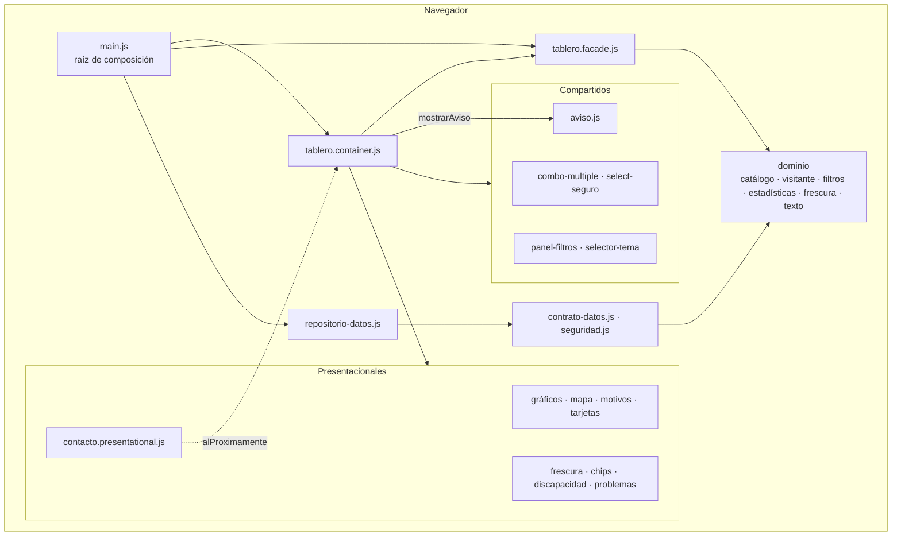
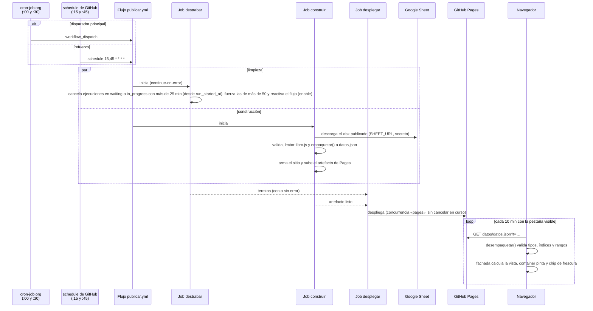

# Arquitectura

## Visión general

Sitio estático sin framework ni paso de build, organizado en **capas semihexagonales**: reglas del negocio
puras en el centro, detalles técnicos alrededor y la interfaz separada en fachada, container y
presentacionales.

El contacto del municipio sigue el mismo camino que el resto de la interfaz: el container le pasa la configuración
(`CONTACTO_MUNICIPIO`) a `contacto.presentational.js`, que dibuja un enlace por cada red con dirección válida y un botón
«Pronto» por cada red sin dirección. Ese botón no abre nada por sí mismo: avisa al container (`alProximamente`), que arma el
contenido con los enlaces disponibles y pide a `aviso.js` que lo muestre. Así el presentacional no importa al compartido y
la regla de dependencias se mantiene.

## Capas

| Capa | Archivos | Qué hace | Qué no hace |
|---|---|---|---|
| **Dominio** | `src/domain/catalogo.js`, `visitante.js`, `filtros.js`, `enlace.js`, `estadisticas.js`, `discapacidad.js`, `frescura.js`, `texto.js` | Normaliza filas, reconoce encabezados, calcula KPI y series, clasifica la frescura de la publicación y limpia texto | No conoce el DOM, la red ni las librerías |
| **Infraestructura** | `src/infrastructure/config.js`, `seguridad.js`, `contrato-datos.js`, `repositorio-datos.js`, `lector-libro.js` | Configuración, descarga acotada, formato de `datos.json`, lectura del Excel (en Actions) | No tiene reglas de negocio |
| **Fachada** | `src/application/tablero.facade.js` | Estado de datos y filtros, opciones de los combos (años y motivos unen visitantes y catálogo), pestaña del mapa, política de actualización, frescura, vista calculada (incluidos los textos que dependen del periodo) y suscripción a eventos | No toca el DOM; recibe la descarga, el reloj y la visibilidad inyectados |
| **Container** | `src/application/components/tablero.container.js` | Traduce eventos del DOM y de los gráficos en acciones de la fachada y pinta su vista | No calcula ni descarga |
| **Presentacionales** | `src/application/components/presentational/*.js` | Dibujan gráficos, mapa por pestañas, motivos con íconos, tarjetas (con variación y cifras animadas), chip de frescura, chips de filtros, problemas de carga y contacto del municipio (`contacto.presentational.js`: enlaces y botones «Pronto») | No guardan estado ni acceden a datos |
| **Compartidos** | `src/application/components/compartidos/*.js` | Combo de varias opciones con búsqueda accesible (casillas, grupos, teclado), llenado seguro de `<select>`, panel de filtros deslizable para celular y tableta, selector de tema y aviso flotante (`aviso.js`: un solo aviso a la vez, solo enlaces `https://`, se cierra con botón, Escape o temporizador) | Ninguna |
| **Shared** | `src/shared/textos.es.js`, `formato.js`, `tema.js`, `tema-inicial.js` | Textos visibles, formato de números y fechas, y lógica del tema. `tema-inicial.js` es un script clásico que se ejecuta antes del primer pintado (ver [ADR 005](decisiones/005-tema-y-excepciones-de-color.md)) | Ninguna |
| **Raíz** | `src/main.js` | Une la infraestructura con la fachada y monta el container | Ninguna |

La regla de dependencias está en [`CONTRIBUTING.md`](../CONTRIBUTING.md#3-arquitectura-la-regla-de-dependencias-no-se-rompe),
y la hace cumplir [`test/arquitectura.test.mjs`](../test/arquitectura.test.mjs).

## Flujo de datos

La publicación la arranca uno de dos disparadores independientes, descritos en el
[ADR 009](decisiones/009-publicacion-con-doble-disparador.md). El flujo
[`publicar.yml`](../.github/workflows/publicar.yml) tiene tres jobs: `destrabar` y `construir` corren en paralelo, y
`desplegar` espera a ambos.

La concurrencia `pages` está solo en `desplegar`. Si estuviera a nivel de flujo, un despliegue atascado retendría el
grupo y cancelaría todas las ejecuciones siguientes, incluida la que debe limpiarlo.

1. **Lectura en Actions:** [`tools/construir-datos.mjs`](../tools/construir-datos.mjs) descarga el libro publicado de la hoja y lo lee con
   [`lector-libro.js`](../src/infrastructure/lector-libro.js). Cada pestaña no reservada es un establecimiento.
   Las filas se normalizan contra `_Catalogos`, y las inválidas quedan como rechazos con su pestaña y su fila.
2. **Empaquetado:** [`contrato-datos.js`](../src/infrastructure/contrato-datos.js) empaqueta las filas como
   índices a diccionarios. Pesan unos 0,8 MB para 30.000 filas.
3. **Validación en el navegador:** el navegador valida el paquete antes de usarlo. Un archivo alterado se
   rechaza entero.

## Ciclo de actualización

Hay dos cadencias distintas y no deben confundirse:

| Cadencia | Valor | Dónde vive | Qué es |
|---|---|---|---|
| **Publicación** | cada 30 minutos (`PUBLICACION_MINUTOS`) | `publicar.yml` y cron-job.org | Con qué frecuencia se genera un `datos.json` nuevo a partir de la hoja |
| **Consulta del navegador** | cada 10 minutos (`INTERVALO_AUTO_MS`) | `tablero.facade.js` | Con qué frecuencia una pestaña abierta vuelve a pedir `datos.json` a Pages |

La consulta es más frecuente que la publicación para que cada ciclo nuevo se vea pronto. El chip de frescura clasifica la edad
de la última publicación con `UMBRALES_FRESCURA`: hasta 45 minutos «al día», hasta 100 «retrasado» y más de 100 «vencido»
(«Publicación detenida»).

El navegador lo implementa [`tablero.facade.js`](../src/application/tablero.facade.js):

| Disparador | Regla |
|---|---|
| Entrada a la página y botón «Actualizar» | Descarga forzada |
| Cambio de establecimiento | Descarga solo si pasaron 60 s o más desde la última (`REUSO_MINIMO_MS`) |
| Automático | Cada 10 min (`INTERVALO_AUTO_MS`), solo con la pestaña visible; se revisa cada 30 s (con la misma revisión se repinta el chip de frescura) |
| Descarga en curso | No se lanza otra en paralelo |
| Error | Se conservan los últimos datos buenos y se muestra el aviso con la hora de esos datos |

## Pruebas por capa

| Carpeta | Qué cubre |
|---|---|
| `test/domain/` | Conciliación exacta con el oráculo en Python en 7 escenarios |
| `test/infrastructure/` | Lector del libro, contrato de datos, seguridad y descarga acotada |
| `test/application/` | Fachada con reloj y descarga simulados, pestañas del mapa, textos del periodo, opciones de los gráficos, contacto del municipio y aviso flotante |
| `test/tools/` | Selección de ejecuciones trabadas de `destrabar-publicacion.mjs` |
| `test/shared/` | Formato, textos que dependen de los filtros y tema (incluido el script inicial, ejecutado en un contexto aislado) |
| `test/tema-tokens.test.mjs` | Todo token de color usado existe |
| `test/arquitectura.test.mjs` | Regla de dependencias |
| `test/sin-azul.test.mjs` | Ningún azul fuera de las excepciones del ADR 005 |

## Formato mensual y filtros de varias opciones

- **Dos formatos de pestaña, una sola forma interna.** [`lector-libro.js`](../src/infrastructure/lector-libro.js) reconoce el formato por los
  encabezados (`mapearEncabezados`). Cada fila del formato mensual se expande en filas internas con la misma forma de siempre; la edad
  interna es el límite inferior del rango (0, 31, 46, 61) y [ADR 007](decisiones/007-formato-mensual-de-captura.md) explica por qué.
- **Discapacidad aparte.** `datos.json` lleva una clave opcional `discapacidad` con filas de ocho números. Un lector anterior la ignora y un
  paquete anterior sin ella sigue siendo válido.
- **Filtros como listas.** [`filtros.js`](../src/domain/filtros.js) guarda una lista por filtro (año y mes, un valor). La fachada agrega,
  quita y limpia opciones; las etiquetas de los filtros activos son una por valor ([ADR 008](decisiones/008-filtros-de-varias-opciones.md)).
