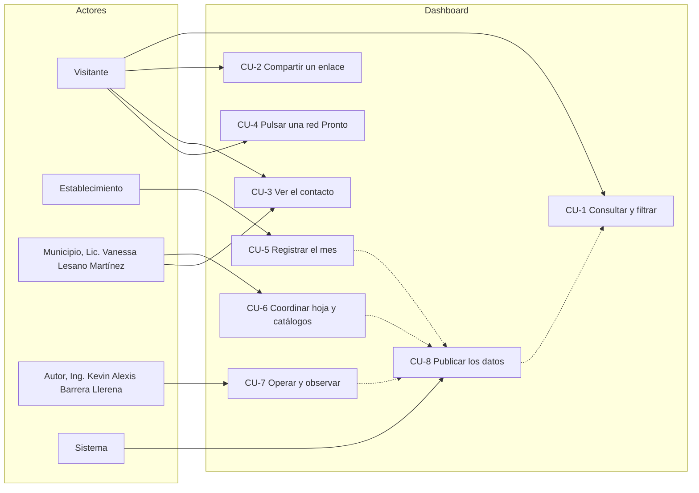

# Casos de uso

Quién usa el dashboard, qué busca y qué ocurre en cada caso. Los valores numéricos se citan por el símbolo de
[`config.js`](../src/tablero/infrastructure/config.js), que es donde se cambian.

Las líneas punteadas indican dependencia: lo que se registra en la hoja llega al visitante solo después de una publicación.

## Visitante

### CU-1 Consultar y filtrar

| Campo | Detalle |
|---|---|
| Actor | Visitante (público general, prensa, personal del municipio) |
| Objetivo | Ver cuántos visitantes llegan a Patate, de dónde vienen y por qué |
| Pasos | 1. Abre el sitio y espera la primera carga. 2. Lee las tarjetas, los gráficos y el mapa. 3. Elige filtros: establecimiento, procedencia, motivo, edad y género aceptan varias opciones; año y mes, una. 4. También puede hacer clic en una barra, un motivo o una provincia del mapa. 5. Quita opciones desde las etiquetas de filtros activos o con «Quitar todos». |
| Resultado | Todas las cifras se recalculan sobre los filtros elegidos; las opciones de un mismo filtro se suman y los filtros entre sí se cruzan. Cada combo se acorta a las opciones con visitantes bajo los demás filtros, sin contar el suyo, y conserva lo ya elegido (`opcionesFacetadas`) |
| Excepciones | Si la descarga falla, se conservan los últimos datos buenos y aparece un aviso con la hora de esos datos. Con una edad de publicación de 46 a 100 minutos, el chip dice «Datos con retraso»; desde el minuto 101 (`UMBRALES_FRESCURA.retrasadoMin` es 100), «Publicación detenida». |

### CU-2 Compartir un enlace

| Campo | Detalle |
|---|---|
| Actor | Visitante |
| Objetivo | Enviar a otra persona la misma vista que está viendo |
| Pasos | 1. Aplica los filtros. 2. Pulsa «Copiar enlace» (o copia la dirección del navegador), que lleva los filtros en el fragmento (`#...`). 3. La otra persona la abre. |
| Resultado | Al cargar los datos, el dashboard aplica los filtros del enlace una sola vez |
| Excepciones | Lo mal formado se descarta: año fuera de 2000 a 2100, mes fuera de 0 a 11, rango de edad desconocido, procedencia que no empieza por `NAC`, `EXT`, `C:`, `P:` o `PR:`, valores de más de 80 caracteres y lo que pase de 20 opciones por filtro. Un valor bien formado que no está en los datos sí se aplica: la vista queda en «Sin visitantes para los filtros elegidos», su etiqueta aparece y se quita con su cruz |

### CU-3 Ver el contacto

| Campo | Detalle |
|---|---|
| Actor | Visitante; también la Lic. Vanessa Lesano Martínez, como titular del contacto |
| Objetivo | Saber a quién escribir por el municipio |
| Pasos | 1. Baja al pie. 2. Lee la tarjeta «Contacto del municipio». 3. Pulsa Facebook (https://www.facebook.com/vane.lesano.martinez) o TikTok, que se abren en una pestaña nueva. |
| Resultado | Se abre la red de la Lic. Vanessa Lesano Martínez |
| Excepciones | Un enlace con dirección inválida (que no sea `https://` o que traiga parámetros) no se muestra. Una red sin dirección se muestra como «Pronto» (CU-4). |

### CU-4 Pulsar una red «Pronto»

| Campo | Detalle |
|---|---|
| Actor | Visitante |
| Objetivo | Intentar abrir el LinkedIn de la Lic. Vanessa Lesano Martínez, que todavía no tiene dirección publicada |
| Pasos | 1. Pulsa el botón LinkedIn marcado «Pronto». 2. El dashboard muestra un aviso flotante que explica que esa red llegará más adelante y ofrece los enlaces disponibles: Facebook y TikTok de la Lic. Vanessa Lesano Martínez, más el Facebook del autor. 3. Cierra el aviso con la cruz, con la tecla Escape o espera a que se cierre solo (10 segundos). |
| Resultado | El visitante llega a un canal de contacto que sí existe |
| Excepciones | El aviso solo acepta enlaces `https://`; los demás se descartan. Un aviso nuevo reemplaza al anterior. Para publicar la red, se escribe su dirección en `CONTACTO_MUNICIPIO.enlaces.linkedin`. |

## Establecimiento

### CU-5 Registrar el mes en su pestaña

| Campo | Detalle |
|---|---|
| Actor | Establecimiento (alojamiento, restaurante u otro prestador turístico de Patate) |
| Objetivo | Que sus visitantes del mes aparezcan en el dashboard |
| Pasos | 1. Abre la hoja compartida y va a la pestaña de su establecimiento. 2. Agrega una fila por mes, procedencia y motivo, con los totales por rango de edad (formato mensual, [ADR 007](decisiones/007-formato-mensual-de-captura.md)). 3. Elige procedencia y motivo de las listas del catálogo. 4. Espera la siguiente publicación. |
| Resultado | Sus datos entran al dashboard en el siguiente ciclo, hasta `PUBLICACION_MINUTOS` minutos después más lo que demore Actions |
| Excepciones | Las filas inválidas no detienen la publicación: quedan como rechazos con su pestaña y su fila y no se cuentan. El lector no lee la columna Estado: una fila nacional sin ciudad («Falta la ciudad») se publica sin ciudad ni provincia. Si las columnas grises se escriben a mano y contradicen el País, o una fila mensual pasa de 450000 visitantes, la fila se publica y queda un aviso con su pestaña y su fila. Una pestaña cuyo nombre empieza por `_` o contiene «plantilla» no se toma como establecimiento. |

## Municipio

### CU-6 Coordinar la hoja, los catálogos y las consultas

| Campo | Detalle |
|---|---|
| Actor | Municipio, en la persona de la Lic. Vanessa Lesano Martínez, Licenciada en Turismo, contacto y apoyo del GAD |
| Objetivo | Mantener la hoja ordenada y resolver las dudas de los establecimientos |
| Pasos | 1. Da de alta una pestaña por establecimiento duplicando la plantilla; el activador del script de la hoja la protege solo. 2. Mantiene las listas de la pestaña `_Catalogos`. 3. Atiende las consultas de los establecimientos sobre cómo registrar. 4. Avisa al autor si una cifra no cuadra o si la publicación se ve detenida. |
| Resultado | La hoja se mantiene consistente y los datos que llegan al dashboard son confiables |
| Excepciones | Los cambios de formato del Excel o de configuración se piden al autor. La guía paso a paso está en [operacion.md](operacion.md). |

## Autor

### CU-7 Diseñar, desarrollar, publicar y monitorear

| Campo | Detalle |
|---|---|
| Actor | Ing. Kevin Alexis Barrera Llerena, autor del dashboard. Rol: diseño, desarrollo, publicación y monitoreo (observabilidad) |
| Objetivo | Que el dashboard siga publicando datos al día y que cualquier falla se detecte y se corrija |
| Pasos | 1. Diseña y desarrolla los cambios con pruebas por capa. 2. Mantiene la cadencia: la tarea de cron-job.org (`workflow_dispatch` en :00 y :30) y el `schedule` de GitHub (`15,45 * * * *`). 3. Revisa el chip de frescura y el registro de cada publicación. 4. Si hay ejecuciones atascadas, comprueba que `destrabar` las canceló (evento `destrabar_fin` en el registro) o las cancela a mano. Comprueba también el evento `flujo_mantenido`, que prueba que el flujo sigue activo. 5. Controla los despliegues y las versiones. |
| Resultado | Publicación continua; cualquier detención se ve en el chip y se resuelve con el procedimiento de [observabilidad.md](observabilidad.md) |
| Excepciones | GitHub puede retrasar el `schedule` bajo carga. Tras 60 días sin actividad desactiva el flujo entero, y entonces también falla el `workflow_dispatch` de cron-job.org; `destrabar` lo evita llamando a `PUT /actions/workflows/{id}/enable` en cada publicación (evento `flujo_mantenido`). Si el flujo aparece desactivado, se reactiva a mano en Actions > Publicar dashboard > «Enable workflow». Si falla cron-job.org, publica el `schedule` en 15 minutos o menos. |

## Sistema

### CU-8 Publicar los datos de forma programada

| Campo | Detalle |
|---|---|
| Actor | Sistema (cron-job.org, GitHub Actions y GitHub Pages) |
| Objetivo | Convertir lo que hay en la hoja en el `datos.json` que lee el navegador |
| Pasos | 1. cron-job.org (:00 y :30) o el `schedule` de GitHub (:15 y :45) inician el flujo. 2. `destrabar` cancela ejecuciones del flujo en `waiting` o `in_progress` con más de `MINUTOS_TRABADA` (25) minutos desde `run_started_at`, fuerza la cancelación si siguen activas pasado el doble y reactiva el flujo (`enable`) para reiniciar el plazo de 60 días. 3. En paralelo, `construir` descarga el libro publicado con `SHEET_URL` y el caso de uso `construir-datos` lo lee, lo valida y genera `datos.json`. 4. `desplegar` publica en Pages, con concurrencia `pages`. 5. Los navegadores abiertos consultan cada `INTERVALO_AUTO_MS` (10 minutos). |
| Resultado | Un `datos.json` nuevo cada 30 minutos con `generadoEn` actualizado |
| Excepciones | Si `construir` falla (hoja inaccesible, libro inválido), no hay despliegue y el sitio conserva la última publicación buena; el chip de frescura envejece hasta «Datos con retraso» (minuto 46) y «Publicación detenida» (minuto 101). Si `destrabar` falla, no bloquea (`continue-on-error`). Ver [ADR 009](decisiones/009-publicacion-con-doble-disparador.md). |
