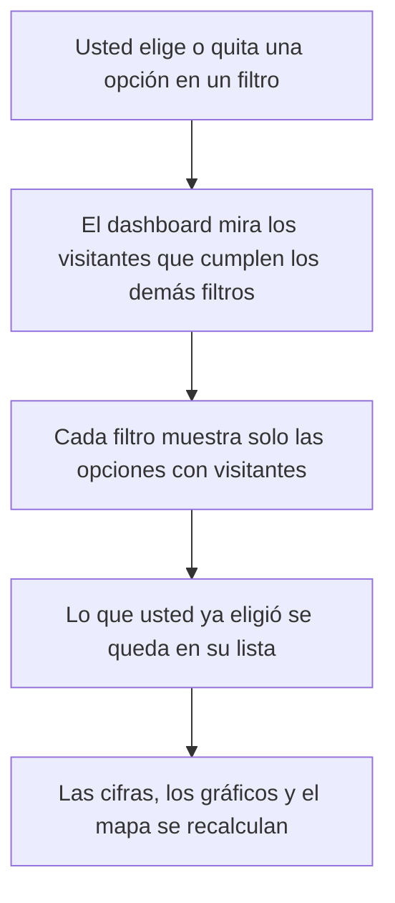

# Manual del usuario

Guía para leer el dashboard «Estadísticas de Visitantes» de los establecimientos turísticos del cantón San Cristóbal de Patate. Está escrita
para el público y para el personal del municipio: no hace falta saber de informática.

Si usted administra la hoja de cálculo, vea el [manual de operación](operacion.md).

## Qué muestra el dashboard

Reúne los visitantes que reportan cada mes los establecimientos turísticos del cantón. Usted puede ver cuántas personas llegaron, de dónde
vinieron, a qué vinieron, qué edad tienen y cuántas reportan una discapacidad. Todo son cifras totales: no aparecen nombres ni datos personales.

Los datos se actualizan solos, sin que usted haga nada.

## La barra de estado

Justo debajo de la cabecera hay una barra con un chip de color y cuatro datos.

### El chip de estado

Dice si la información que está viendo es reciente. Se calcula con el tiempo que pasó desde la última publicación.

| Lo que dice | Color del punto | Qué significa |
|---|---|---|
| **Datos al día** | Verde | La última publicación fue hace 45 minutos o menos |
| **Datos con retraso** | Amarillo | Pasaron entre 46 y 100 minutos. Los datos siguen siendo válidos, pero la actualización se demora |
| **Publicación detenida** | Marrón | Pasaron más de 100 minutos. La actualización automática no está funcionando |

Junto al chip aparece cuánto hace que se publicaron los datos. Si el chip dice «Sin verificar», la fecha de los datos falta o no cuadra con el reloj de su equipo; revise que la hora de su equipo sea la correcta.

### Los cuatro datos

| Dato | Qué le dice |
|---|---|
| **Última publicación** | La hora en que se prepararon los datos que está viendo. Se renuevan cada 30 minutos |
| **Periodo con datos** | El primer y el último mes que tienen registros |
| **Establecimientos con datos** | Cuántos establecimientos ya reportaron al menos un mes, sobre el total, por ejemplo «17 de 39» |
| **Registros mensuales** | Cuántas filas de información hay. Cada fila es un mes de un origen y un motivo de visita. **No es el número de visitantes** |

A la derecha de la barra hay dos botones: la **luna** cambia entre modo claro y oscuro, y **Actualizar** vuelve a descargar lo ya publicado.

## Cómo leer cada panel

### Total de visitantes

La cifra grande es el total de visitantes según los filtros que usted tenga puestos. Debajo aparece su variación frente al mismo periodo
del año anterior:

- **Flecha hacia arriba** con un porcentaje: hubo más visitantes que el año anterior.
- **Flecha hacia abajo** con un porcentaje: hubo menos.
- **«Sin datos del año anterior»**: no hay con qué comparar, por ejemplo en el primer año de registros.

### Nacionales y extranjeros

Dos tarjetas con la cantidad y el porcentaje de visitantes nacionales (de Ecuador) y de extranjeros. Los dos porcentajes suman 100 %.

### Evolución de visitantes por mes

Barras que comparan mes a mes el año elegido con el anterior, con una línea de tendencia del año elegido. Sirve para ver en qué meses llegan
más visitantes y si el año va mejor o peor que el pasado. **Si toca una barra, el dashboard se filtra por ese mes**; vuelva a tocarla para quitarlo.

### Nacionales vs extranjeros

Un gráfico circular con la misma proporción de las tarjetas. En el centro está el total de visitantes y, debajo, una frase que resume el reparto.

### Distribución por edad y género

Barras por rango de edad (0 a 30, 31 a 45, 46 a 60 y 61 o más), separadas en **Total mujeres** y **Total hombres**. La leyenda indica el total
y el porcentaje de cada género.

### Motivo de visita

Una lista de los motivos por los que viajaron las personas con su cantidad. **Si toca un motivo, el dashboard
se filtra por él**; vuelva a tocarlo para quitarlo.

### Origen de visitantes

Un mapa con círculos: mientras más grande el círculo, más visitantes de ese lugar. Con los botones de arriba cambia lo que se muestra:

| Botón | Qué muestra |
|---|---|
| **Provincias** | Las provincias de Ecuador de donde vienen los visitantes |
| **Ciudades** | Las ciudades de Ecuador |
| **Países** | Los países de los visitantes extranjeros |

Los extranjeros cuyo país no anotó el establecimiento aparecen como **«Extranjeros (sin especificar)»**: cuentan en las cifras y en los
filtros, pero no tienen círculo en el mapa.

Junto al mapa hay una lista con los primeros lugares (por ejemplo, «Top ciudades»). Solo aparecen los lugares que tienen visitantes en lo
que usted eligió.

### Personas con discapacidad

Muestra cuántas personas con discapacidad reportan los establecimientos y qué parte de los visitantes representan. Debajo, una lista
indica en cuántos registros mensuales se reportaron de 1 a 5 personas, de 6 a 10, de 11 a 15 y, si los hay, 16 o más.

Este panel **no responde a los filtros de edad ni de género**, porque esa información no se recoge por separado. Se publica solo como cifra total.

## Los filtros

Los filtros están a la izquierda. En celular o en una ventana angosta se reúnen en el botón **Filtros**, que abre un cuadro con las mismas opciones.

| Filtro | Cómo funciona |
|---|---|
| **Establecimiento** | Admite **varias opciones**. Escriba para buscar; si no elige ninguno, se ven todos los establecimientos |
| **Año** y **Mes** | Se elige **una sola opción** en cada uno |
| **Procedencia** (país, ciudad o provincia) | Admite **varias opciones** |
| **Motivo de visita**, **Edad** y **Género** | Admiten **varias opciones** |

Cómo se combinan: dentro de un mismo filtro las opciones se **suman** (Colombia y Perú). Entre filtros distintos se **cruzan** (visitantes de
Colombia o Perú, y además por turismo).

### Los filtros solo ofrecen lo que tiene datos

Cuando usted elige algo en un filtro, los **demás** filtros se acortan y solo muestran las opciones que tienen visitantes con lo que ya eligió.
Por ejemplo, si elige un establecimiento, el filtro de procedencia muestra solo los lugares de donde llegaron visitantes a ese establecimiento,
y el de año, solo los años en que reportó. Así no hace falta probar opciones que darían cero.

- **El filtro que usted está usando no se acorta a sí mismo.** Si eligió Colombia, en Procedencia siguen apareciendo los demás países, para que
  pueda sumar otro.
- **Lo que ya eligió no desaparece.** Si una opción elegida se queda sin visitantes por otro filtro, sigue en su lista, marcada, para que pueda
  quitarla.
- **Al quitar un filtro, las opciones vuelven.** Da igual cómo lo quite: con la cruz de una etiqueta, con **Quitar todos**, desde el panel del
  celular o volviendo a tocar un motivo o un gráfico. Lo mismo pasa al abrir un enlace compartido: los filtros se acortan igual que si los hubiera
  elegido a mano.

### Etiquetas

Cada opción que usted elige aparece como una etiqueta sobre los gráficos. Para quitar una, pulse la cruz de esa etiqueta. Cuando hay dos o
más etiquetas aparece **Quitar todos**, que las borra de una vez.

El botón **Limpiar filtros**, dentro del panel de filtros, regresa todo al estado inicial.

Si los filtros dejan el dashboard sin resultados, verá el mensaje «Sin visitantes para los filtros elegidos». Pulse **Limpiar filtros** y
empiece de nuevo.

## Compartir lo que está viendo

Cuando hay al menos un filtro puesto, junto a las etiquetas aparece el botón **Copiar enlace**. Al pulsarlo, el botón dice «Enlace copiado» y
usted puede pegar la dirección en un mensaje o correo. Quien la abra verá el dashboard con los mismos filtros.

Si dice «No se pudo copiar», copie la dirección desde la barra de su navegador: tiene los mismos filtros.

## Imprimir

Use la función de imprimir de su navegador (Ctrl + P). La página se ajusta para el papel y oculta los botones y filtros, que no sirven en una hoja.

## Modo oscuro

Pulse el botón de la **luna** en la barra de estado para pasar a modo oscuro, más cómodo de noche. Pulse el sol para volver. El dashboard
abre en modo claro por defecto; si usted elige el modo oscuro, se recuerda en ese dispositivo.

## El pie de la página

Al final de la página, el pie tiene tres partes:

1. **Tres columnas** con lo básico: «Acerca del dashboard», «Privacidad y seguridad» y «Fuentes y licencias».
2. **La franja del GAD Municipal de San Cristóbal de Patate**, con su escudo y la foto y el nombre del **Ing. Emerson Hernán Medina Castro,
   Alcalde, Administración 2023 a 2027**, los agradecimientos y el botón **Sitio del GAD**, que abre la página oficial del municipio.
3. **Dos tarjetas** con las personas a cargo:

| Tarjeta | Quién | Rol |
|---|---|---|
| **Contacto del municipio** | **Lic. Vanessa Lesano Martínez** | Licenciada en Turismo. Contacto y apoyo del GAD Municipal de Patate |
| **Diseño y desarrollo** | **Ing. Kevin Alexis Barrera Llerena** | Ingeniero de Software. Diseño, desarrollo, publicación y monitoreo del dashboard |

Cada tarjeta tiene sus enlaces a redes sociales, que se abren en una pestaña nueva. Si una red dice **«Pronto»**, todavía no tiene enlace publicado:
al pulsarla aparece un aviso con los enlaces que sí están disponibles. Si una foto no carga, se ven las iniciales de la persona.

La última línea dice quién hizo el dashboard, de quién son los datos y de dónde salen las fotos: la del alcalde, del sitio oficial del GAD; las
demás, publicadas con autorización de cada persona.

## Qué hacer si el chip dice «Publicación detenida»

Significa que la actualización automática dejó de funcionar. Las cifras que ve siguen siendo las últimas buenas, pero pueden estar atrasadas.

1. Pulse **Actualizar** y espere unos segundos, por si fue un fallo pasajero.
2. Si el chip sigue en «Publicación detenida», **avise al autor** (Ing. Kevin Alexis Barrera Llerena) con los enlaces del pie.
   Dígale la hora de la última publicación que muestra la barra.

No intente corregirlo usted: la solución está en el servidor y la aplica el autor.
