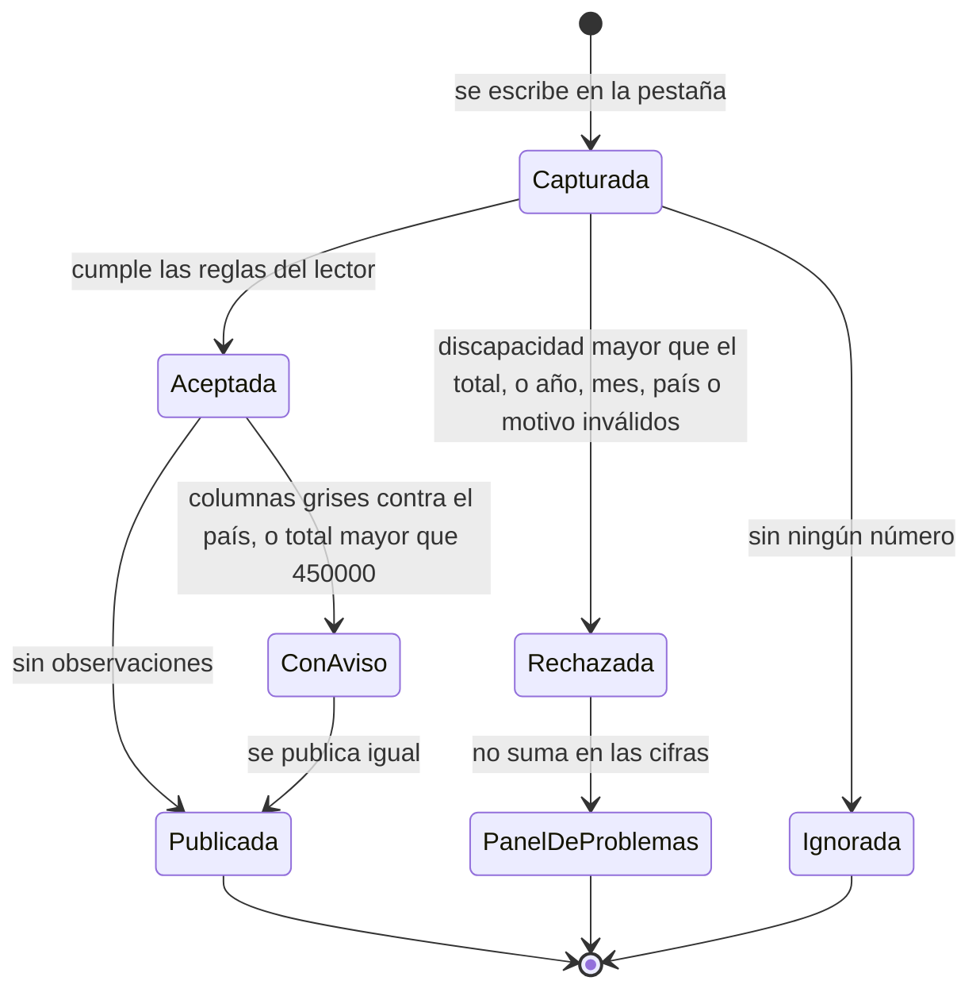

# Manual de operación

Guía para quien administra la hoja de cálculo y el dashboard. No hace falta saber programar. Para aprender a leer el dashboard, vea el [manual del usuario](manual-usuario.md).

## Importar el Excel a Google Sheets

Cuando se genera un libro nuevo con [`tools/excel/generar-excel.py`](../tools/excel/generar-excel.py), se sube a Google Sheets así. Su primera
pestaña, `_Inicio`, trae las instrucciones de uso.

1. Abra la hoja de cálculo de Google que ya usa el municipio.
2. Menú **Archivo > Importar**.
3. Pestaña **Subir** y elija el archivo `.xlsx` (o arrástrelo).
4. En «Ubicación de importación» marque **Reemplazar hoja de cálculo** y pulse **Importar datos**. Con esa opción la hoja conserva su
   dirección y sus permisos.
5. Menú **Archivo > Compartir > Publicar en la web**.
6. En «Vínculo», elija **Documento completo** y, en el segundo desplegable, el formato **Microsoft Excel (.xlsx)**.
7. Deje marcada la casilla **Volver a publicar automáticamente cuando se hagan cambios** y pulse **Publicar**.
8. Copie el enlace que aparece. **Ese enlace publicado es el que va en el secreto `SHEET_URL`** del repositorio. Lo configura el autor del dashboard;
   si el enlace cambió, envíeselo (ver [configuracion.md](configuracion.md#rotar-la-url)).

Si solo reemplazó el contenido y el enlace publicado no cambió, no hay que tocar nada más: la siguiente publicación ya usa los datos nuevos.

## Cómo llegan los datos al dashboard

1. Cada establecimiento llena **su propia pestaña** en la Google Sheet compartida.
2. Esa hoja está publicada en la web como Excel (.xlsx). Cada 30 minutos, GitHub Actions descarga el Excel publicado, lo valida y
   publica el dashboard con los datos nuevos en GitHub Pages.
3. Quien visita el dashboard ve la hora de la última publicación y un chip de estado: «Datos al día» hasta el minuto 45, «Datos con retraso»
   desde el 46 y «Publicación detenida» desde el 101. Ver [observabilidad.md](observabilidad.md).

No hay que subir ni enviar nada: basta con escribir en la hoja de Google. Si la publicación falla, el dashboard conserva los últimos datos buenos.

**Cuánto tarda un dato nuevo en aparecer:** hasta unos 35 minutos al recargar la página y unos 45 con la página abierta (la publicación corre
cada 30 minutos y el navegador consulta cada 10). Google republica la hoja cada ~5 minutos, así que ese tiempo ya está incluido. GitHub puede
retrasar su `schedule` de refuerzo en horas de mucha carga.

### Cadencia de la publicación

| Quién la arranca | Cuándo | Para qué |
|---|---|---|
| cron-job.org, una sola tarea | Cada 30 minutos, en punto y a la media (:00 y :30) | Disparador principal |
| `schedule` de GitHub (`15,45 * * * *`) | Cada 30 minutos, a los :15 y :45 | Refuerzo: si uno falla, el otro publica en 15 minutos o menos |
| Un cambio de código en `main` | Al subirlo | Corre las pruebas antes de publicar |

La cifra de 30 minutos vive en `PUBLICACION_MINUTOS` de `src/tablero/infrastructure/config.js`. Cómo se configura cron-job.org está en
[Cómo se dispara la publicación](#cómo-se-dispara-la-publicación-cron-joborg).

### Qué quieren decir las cifras de la barra de estado

La barra muestra cuatro datos y, debajo de cada uno, una explicación visible. La hora de consulta del navegador ya no se muestra.

| Dato | Explicación visible | Qué cuenta |
|---|---|---|
| **Última publicación** | Datos nuevos cada 30 minutos | La hora en que Actions construyó los datos a partir de la hoja. No es la hora en que alguien escribió en el Excel |
| **Periodo con datos** | Primer y último mes cargados | El primer y el último mes con registros, por ejemplo «ene 2025 a sep 2026» |
| **Establecimientos con datos** | Con al menos un mes registrado | «17 de 39»: cuántas pestañas de establecimiento tienen al menos un registro válido, sobre el total de pestañas que cuentan como establecimiento |
| **Registros mensuales** | Cada uno: un mes, un origen y un motivo | Filas de la hoja: cada una es un mes de un origen y un motivo de visita en un establecimiento. No es el número de visitantes |

## Qué pestañas cuentan como establecimiento

Todas, excepto:
- las que **empiezan con `_`**, como `_Inicio` y `_Catalogos`;
- las que **contienen «plantilla»**, como `Plantilla`, `Plantilla (2)` y `Copia de Plantilla`.

El nombre de la pestaña es el nombre que aparece en el dashboard.

## Columnas de cada pestaña

El dashboard reconoce **dos formatos** por los encabezados de la pestaña. Una misma pestaña no puede mezclarlos: si lo hace, se omite y
el aviso lo dice.

### Formato mensual (el de la plantilla)

Cada fila es **un mes de un origen y un motivo**. Usted escribe los números; la hoja calcula los totales y marca en rojo lo que no cuadra.

| Escribe usted | Calcula la hoja (columnas grises) |
|---|---|
| Año, Mes, País, Ciudad, Motivo de visita, Mujeres 0-30, 31-45, 46-60, 61+, Hombres 0-30, 31-45, 46-60, 61+, Personas con discapacidad | Provincia, Total mujeres, Total hombres, Total visitantes, Nacionales, Extranjeros, Estado |

- **Los ocho números** son enteros de 0 en adelante. Una celda vacía cuenta como cero y una fila sin ningún número se ignora.
- **Personas con discapacidad** no puede superar el total de visitantes de la fila. La hoja no deja escribir un valor mayor y la fila se pinta de
  rojo; si aun así llegara al dashboard, esa fila se rechaza con su pestaña y su fila.
- **Estado** dice «OK» o qué corregir («Revisar: discapacidad 19 mayor que el total 16», «Falta año, mes, país o motivo», «Falta la ciudad») y
  la fila se pinta de rojo. Es una ayuda para quien llena la hoja: **el dashboard no lee esa columna**, aplica sus propias reglas. Qué pasa con
  cada caso está en [Ciclo de una fila](#ciclo-de-una-fila).
- **Visitantes extranjeros: siempre en una fila aparte.** Una fila con País Ecuador cuenta todos sus visitantes como nacionales. Los
  extranjeros del mismo mes y motivo van en otra fila con **su país** (la ciudad queda vacía). Si no se sabe de qué país eran, se elige
  **«Extranjeros (sin especificar)»**: cuenta como extranjero en las cifras, aparece en los filtros y en el «Top países», pero no tiene
  círculo en el mapa, porque no tiene coordenadas.
- **Nacionales y extranjeros** se calculan por el país: Ecuador es nacional. Las columnas grises tienen fórmulas y **no se escriben**: las protege
  el script de la hoja (ver [Protección de las columnas grises](#protección-de-las-columnas-grises)). Aunque alguien las escribiera a mano, el
  dashboard sigue usando el país y avisa.
- **Por qué ocho columnas y no una por género:** así el dashboard puede filtrar por edad y por género a la vez y mostrar «Total mujeres» y
  «Total hombres» por rango de edad con cifras exactas.

### Formato anterior (sigue funcionando)

| Año | Mes | País | Provincia | Ciudad | Cantidad | Motivo de visita | Edad | Género |
|---|---|---|---|---|---|---|---|---|

- **Cada fila es un grupo de visitantes** con el mismo mes, procedencia, motivo, edad y género. Una persona
  sola se anota con Cantidad = 1.
- **Nacional o extranjero no se escribe:** el dashboard lo deduce del País (Ecuador = nacional).
- **Edad** es un número entero de 0 a 110. El dashboard la agrupa en 0-30, 31-45, 46-60 y 61+.
- **Visitantes extranjeros:** Provincia y Ciudad quedan vacías.
- **No se escriben datos personales:** ni nombres, ni cédulas, ni teléfonos.
- **No se mueven ni se renombran las columnas.** El dashboard las reconoce por su nombre, con variantes (por
  ejemplo «Motivo» o «Motivo de visita», «Sexo» o «Género»). **Provincia y Ciudad son opcionales**; las demás son
  obligatorias.
- **Las personas con discapacidad solo existen en el formato mensual.** Una columna con ese nombre en una pestaña del formato anterior se ignora.

## Ciclo de una fila

Qué pasa con cada fila desde que se escribe hasta que se ve en el dashboard:

- **Ignorada:** una fila sin ningún número no cuenta ni se avisa.
- **Rechazada:** sus cifras no entran en el dashboard. Aparece en el aviso «N filas con problemas», con la pestaña, el número de fila y el motivo.
- **Con aviso:** sus cifras sí entran. El aviso aparece en el mismo panel, en «N avisos», con la pestaña y la fila.
- **Una fila nacional sin ciudad**, que la hoja marca «Falta la ciudad», se acepta: cuenta como nacional, sin ciudad ni provincia, y no aparece en
  el mapa de ciudades ni de provincias.

### La página de revisión

Los avisos y las filas rechazadas **no los ve el público**. Se ven en la misma dirección del dashboard con `?revision` al final:

`https://alexis-vscode.github.io/turismo-patate/?revision`

Ahí aparece el panel de problemas con la pestaña, la fila y el motivo de cada uno. Es para quien corrige la hoja: el municipio y el autor.
La dirección no es secreta, pero no está enlazada desde ningún lado. Un aviso corregido en la hoja desaparece en la siguiente publicación.

### Qué hacer con los avisos

| Aviso | Qué significa | Qué hacer |
|---|---|---|
| «Fila N: Nacionales dice ... y Extranjeros dice ..., pero con el país ... deben ser ...» | Alguien escribió a mano en una columna gris y no coincide con el país | El dashboard ya usa el país. Si el país está mal, corríjalo; si no, vuelva a poner la fórmula en la columna gris (cópiela de la fila de arriba) |
| «Fila N: ... visitantes en una sola fila, más que el tope de 450000» | El total de la fila pasa de `UMBRAL_FILA_SOSPECHOSA` (450000) | Revise si sobra una cifra, por ejemplo un cero de más. Si la cifra es real, no hay que hacer nada: la fila ya se publica |
| «Hay N filas más con avisos en esta pestaña: revísela completa» | Una pestaña tiene más de 20 filas con avisos. Solo se guardan los primeros 20 para no inflar los datos del sitio | Corrija la causa común, casi siempre fórmulas grises escritas a mano en toda la pestaña, y espere la siguiente publicación |

Los avisos desaparecen solos en la siguiente publicación después de corregir la hoja.

**Corrección del 17/10/2026.** Las columnas grises se bloquearon ese día. Antes, 34 filas con País Ecuador traían escritos a mano los
nacionales y los extranjeros, y el dashboard contaba a todos como nacionales. Cada una se partió en dos: la fila Ecuador con los nacionales y
una fila nueva con «Extranjeros (sin especificar)» y los extranjeros, con el mismo año, mes y motivo. Los totales quedaron exactos. La edad
y el género de los extranjeros no se habían anotado, así que se repartieron en la misma proporción que la fila original: es la única cifra
estimada. Además, la fila 2 de «Plantillas» tenía escritos 960 y 240 en lugar de sus fórmulas y cada pestaña duplicada los heredaba: se
repuso la fórmula en la plantilla y en todas las pestañas. Quedan para confirmar con su establecimiento dos filas cuyos números escritos a
mano no cuadran con su total. Se ven en la [página de revisión](#la-página-de-revisión).
Antes de corregir se guardó la versión «Antes de corregir extranjeros 17-10-2026» en el historial de Google.

## Agregar un establecimiento

1. Haga clic derecho en la pestaña de plantilla y elija **Duplicar**. En el libro que genera el script se llama `Plantilla`; en la hoja del
   municipio, `Plantillas`. Ninguna pestaña que contenga «plantilla» en el nombre cuenta como establecimiento.
2. Renombre la copia con el nombre del establecimiento. Ese nombre es el que aparece en el dashboard.
3. Llene una fila por mes, origen y motivo, con los desplegables.

La copia hereda los desplegables, las fórmulas y el formato de la plantilla. La protección de las columnas grises **no** se copia al duplicar,
pero la pone sola el activador del script de la hoja en cuanto aparece la pestaña nueva (comprobado el 17/10/2026). Para confirmarlo, abra
*Datos > Proteger hojas y rangos* en la pestaña nueva: debe figurar «Dashboard: solo se escriben las celdas blancas».

Aparece en el dashboard en la siguiente publicación, hasta unos 35 minutos después: en el combo, en los filtros, en las tarjetas y en el mapa.

## Protección de las columnas grises

La pone [`tools/excel/proteger-hoja.gs`](../tools/excel/proteger-hoja.gs), un Apps Script instalado en la hoja de Google. Cada pestaña de
captura queda bloqueada salvo las celdas blancas de entrada, y solo el propietario de la hoja edita lo bloqueado. Las pestañas que empiezan con
`_` no se tocan.

- **Instalación, una sola vez y con la cuenta propietaria:** *Extensiones > Apps Script*, pegar el archivo, guardar y ejecutar
  `protegerColumnasGrises`. Luego, en *Activadores*, agregar uno para `alAgregarPestana` con la fuente «De una hoja de cálculo» y el evento
  «Al producirse un cambio».
- **Se puede ejecutar varias veces:** salta las pestañas que ya tienen su protección.
- **`restaurarFormulasGrises`** vuelve a poner las fórmulas grises de la plantilla en todas las filas con datos. Borra lo escrito a mano en
  esas columnas: úsela solo después de pasar esos números a filas propias.
- **`agregarExtranjerosSinEspecificar`** agrega «Extranjeros (sin especificar)» a la lista de países de `_Catalogos` si falta.
- **Si importa un Excel nuevo** con *Reemplazar hoja de cálculo*, Google no conserva la protección del archivo: vuelva a ejecutar
  `protegerColumnasGrises` y compruebe que el activador siga en la lista.
- Es una protección contra errores, no contra mala fe. Por eso el lector, además, avisa cuando las columnas grises no cuadran con el país.
  Detalle en [`tools/excel/README.md`](../tools/excel/README.md).

## Catálogos (`_Catalogos`)

Alimentan los desplegables de la hoja y el mapa. Están en **cuatro bloques**, separados por una columna vacía y con un color de
encabezado distinto, y cada pareja de datos queda pegada:

| Bloque | Columnas |
|---|---|
| Listas | Año, Mes, Motivo, Género |
| Países | País, Pais_Lat, Pais_Lon |
| Ciudades de Ecuador | Ciudad, Ciudad_Provincia, Ciudad_Lat, Ciudad_Lon |
| Provincias | Provincia, Provincia_Lat, Provincia_Lon |

- **Cómo agregar algo:** escríbalo en la primera fila vacía del bloque. Los desplegables de todas las pestañas llegan hasta la fila 1000,
  así que lo nuevo aparece solo.
- **Cómo ordenar:** seleccione el bloque completo y use *Datos > Ordenar rango*. Nunca ordene una columna suelta: separaría la ciudad de
  su provincia y de sus coordenadas.
- **Repetidos:** la hoja rechaza un nombre que ya existe y pinta de rojo los repetidos. Si aun así llegara uno al dashboard, el aviso de
  «filas con problemas» lo indica y se conserva el primero.
- **Coordenadas de provincia:** son el centro aproximado de su contorno en el mapa. Hoy sirven de referencia; el dashboard ubica las burbujas
  con el contorno.

**Qué opciones ofrecen los combos del dashboard.** Una regla simple, para saber dónde tocar. La tabla vale **sin otros filtros puestos**; con
filtros puestos, cada combo se acorta a lo que tiene visitantes bajo los demás filtros (ver [Varias opciones en los filtros](#varias-opciones-en-los-filtros)).

| Combo | De dónde sale | Qué significa |
|---|---|---|
| **Año** y **Motivo** | Los visitantes **y** el catálogo | Un año o motivo nuevo aparece al agregarlo en `_Catalogos`, aunque todavía no tenga visitantes. Si se elige uno sin visitantes, el dashboard dice «Sin visitantes para los filtros elegidos» |
| **Ciudad, país y provincia** | Solo los visitantes | El catálogo trae más de 200 ciudades y 190 países sin visitantes; ofrecerlos todos llenaría el filtro de opciones vacías. Los desplegables de la hoja, en cambio, sí ofrecen todo el catálogo |
| **Mes** y **rango de edad** | Fijos | Los 12 meses y los rangos 0-30, 31-45, 46-60 y 61+ |
| **Establecimiento** | Las pestañas | Todas las pestañas que cuentan como establecimiento, tengan datos o no |

Para abrir un año nuevo basta escribirlo en la columna Año de `_Catalogos`. Los desplegables de las pestañas leen ese
mismo rango, así que también aparecerá al capturar.
- **Coordenadas:** `Ciudad_Lat`/`Ciudad_Lon` y `Ciudad_Provincia` para cada ciudad; `Pais_Lat`/`Pais_Lon` para
  cada país.

Para sumar una ciudad o un país, agréguelo en su columna con las coordenadas. Si una fila trae un valor que no
está en el catálogo, el dashboard **no la descarta en silencio**: la muestra en el aviso «N filas con problemas»,
con la pestaña y el número de fila.

## Permisos recomendados en Google

- **Compartir > Acceso general: Restringido**, con los establecimientos y el personal del municipio agregados como **editores**. Nadie más abre
  la hoja. La publicación en la web es otra cosa: genera un enlace de solo lectura en xlsx, que vive solo en el secreto `SHEET_URL`.
- **Columnas grises:** las protege el script de la hoja, como se explica arriba.
- **Opcional:** proteja `_Catalogos`, y cada pestaña para que solo la edite su establecimiento (*Datos > Proteger hojas y rangos*).

## Respaldo de la hoja

El respaldo es el **historial de versiones de Google** (*Archivo > Historial de versiones > Ver historial de versiones*): guarda las versiones
anteriores y permite restaurar una o copiarla como hoja nueva. Antes de un cambio grande, por ejemplo antes de importar un Excel nuevo, use
*Asignar un nombre a la versión actual* para ubicarla después.

El dashboard **no** guarda copias de la hoja: en un repositorio público, cualquier archivo que se subiera como artefacto de Actions lo podría
descargar cualquier cuenta de GitHub.

## Cómo se dispara la publicación (cron-job.org)

La publicación la arranca principalmente **cron-job.org**, un servicio externo gratuito. Se configura una **sola tarea** que corre **cada 30 minutos,
en punto y a la media** (:00 y :30), todo el día. La tarea llama a la API de GitHub para ejecutar el flujo «Publicar dashboard»
(`workflow_dispatch`) con un token de GitHub. El token es una credencial: se guarda solo en cron-job.org y no se comparte.

Cómo debe ser el token:

- **De grano fino** (*Settings > Developer settings > Fine-grained tokens*), no un token clásico, que da acceso a todos los repositorios de la
  cuenta.
- **Solo este repositorio** y un único permiso: **Actions: Read and write**, el que pide `workflow_dispatch`.
- **Con vencimiento**, y la fecha de renovación anotada. Al vencer, cron-job.org recibe un `401` y deja de disparar sin que el sitio lo diga: la
  publicación sigue solo con el `schedule` de GitHub, que puede retrasarse. Renuévelo antes y reemplácelo en la tarea de cron-job.org.

Como refuerzo, GitHub tiene su propio horario (`schedule`) en los minutos :15 y :45. Así, si cron-job.org falla, GitHub publica a los 15 minutos
como máximo, y al revés. Además, en cada publicación el job `destrabar` llama a `PUT /actions/workflows/{id}/enable`, que mantiene activo el flujo
y reinicia el plazo de 60 días de GitHub (evento `flujo_mantenido`). Detalle en [observabilidad.md](observabilidad.md#los-disparadores) y [configuracion.md](configuracion.md#disparadores-de-la-publicación).

## Si algo falla

**Publicación trabada (runbook).** Síntoma: el chip dice «Publicación detenida» (desde el minuto 101) desde hace horas y en **Actions > Publicar dashboard** las ejecuciones
salen todas como «cancelled».

- **Qué pasó en el incidente real (6 al 12 de octubre de 2026):** un despliegue de Pages quedó en estado `waiting` y retuvo el grupo de
  concurrencia `pages`. Las ejecuciones siguientes se fueron cancelando una tras otra (1.844 en total) y el dashboard estuvo seis días sin datos nuevos.
- **Qué hace ahora el sistema solo:** al inicio de cada publicación corre el job `destrabar` (`tools/destrabar-publicacion.mjs`), que cancela toda
  ejecución del flujo que lleve más de 25 minutos en `waiting` o `in_progress`, contados desde que arrancó (`run_started_at`). Si una ejecución sigue activa pasado el doble (50 minutos), la cancela a la fuerza con la API `force-cancel`. La concurrencia quedó solo en el despliegue, de modo que la
  limpieza corre aunque otra ejecución esté trabada. Si la limpieza fallara, la publicación sigue igual.
- **Si no quiere esperar a la siguiente publicación (cancelar a mano):**
  1. Abra **Actions > Publicar dashboard**.
  2. Entre en la ejecución que esté en `waiting` o `in_progress` desde hace mucho.
  3. Pulse **Cancel workflow**. Si no basta, no hace falta nada más: `destrabar` la fuerza sola en la siguiente publicación, con la API `force-cancel`, cuando la ejecución sigue activa pasado el doble de 25 minutos.
  4. Lance una publicación nueva con **Run workflow** y compruebe que termine en verde.

| Síntoma | Qué revisar |
|---|---|
| El dashboard muestra «No se pudo actualizar...» | El dashboard conserva los últimos datos buenos. Revise la pestaña **Actions** del repositorio: la última ejecución en rojo dice en qué paso falló |
| Actions falla en «Construir datos desde la hoja» | La hoja dejó de estar publicada o cambió su URL. Ver [configuracion.md](configuracion.md#rotar-la-url) |
| Actions falla en «Pruebas» | Un cambio de código rompió una regla. No se publica nada hasta corregirlo |
| Un establecimiento no aparece | Compruebe que su pestaña no empiece con `_`, no contenga «plantilla» y conserve los encabezados. En el dashboard, quite los filtros: el combo solo ofrece lo que tiene visitantes bajo los demás filtros |
| En `?revision` aparece «N filas con problemas» | Despliegue el aviso: indica pestaña, fila y motivo (por ejemplo, `Ciudad fuera del catálogo: «Ambatoo»`). Las erratas de mes como «agosoto» se corrigen solas |
| El chip dice «Publicación detenida» | La publicación automática no corre. Revise **Actions** y siga [observabilidad.md](observabilidad.md#qué-hacer-si-el-chip-no-está-en-verde) |
| cron-job.org marca la tarea con error `401` o `403` | El token venció o perdió el permiso: en **Actions** solo aparecen ejecuciones de `schedule`. Genere un token nuevo como se explica arriba y péguelo en la tarea |
| El panel de problemas muestra avisos de columnas grises o de fila sospechosa | Ver [Qué hacer con los avisos](#qué-hacer-con-los-avisos). La fila ya se publicó |
| Ninguna publicación corre, ni la de cron-job.org ni la de GitHub | GitHub desactiva el flujo entero tras 60 días sin actividad, y entonces también falla el disparo de cron-job.org. `destrabar` lo evita reactivando el flujo en cada publicación. Si aun así aparece desactivado, en **Actions > Publicar dashboard > «Enable workflow»** se reactiva a mano y con **Run workflow** se fuerza una publicación |

## Datos reales y datos de prueba

El dashboard ya publica los datos reales del municipio: `DATOS_DE_PRUEBA` está en `false` en
[`src/tablero/infrastructure/config.js`](../src/tablero/infrastructure/config.js) y la franja amarilla «DATOS DE PRUEBA» no aparece. Esa franja solo se
usaría de nuevo si se pusiera el valor en `true` para probar con una hoja ficticia.

**Dónde vive cada dato.** Los datos reales viven solo en la hoja de Google, a la que entran únicamente sus editores. El
repositorio es público y no guarda ninguna cifra real: los libros de [`test/fixtures/`](../test/fixtures) y los que arman
[`tools/generar-piloto.py`](../tools/generar-piloto.py) y [`tools/excel/generar-excel.py`](../tools/excel/generar-excel.py) son
ficticios. Si alguien entrega un archivo con cifras de un establecimiento, se copian en su pestaña de la hoja, nunca en el código.

Para cambiar la foto de la cabecera, reemplace [`assets/fondo-cabecera.jpg`](../assets/fondo-cabecera.jpg) por una propia del GAD, con el mismo
nombre, y actualice el crédito en `index.html` y en `THIRD_PARTY_NOTICES.md`.

## Publicar el LinkedIn de la Lic. Vanessa Lesano Martínez

Este cambio **lo hace el autor del dashboard**, porque es una edición del código (`config.js`). Quien administra la hoja solo le entrega la
dirección del perfil.

La Lic. Vanessa Lesano Martínez es Licenciada en Turismo. El pie del dashboard, en la tarjeta «Contacto del municipio», muestra sus tres redes, siempre en este orden: Facebook, TikTok y LinkedIn. Facebook y TikTok ya
tienen su enlace (el de Facebook es https://www.facebook.com/vane.lesano.martinez). LinkedIn está vacío: mientras siga así, su botón dice **«Pronto»** y, al pulsarlo, abre un aviso con los otros enlaces.

Para publicarlo:

1. La Lic. Vanessa Lesano Martínez copia la dirección de su perfil de LinkedIn. Debe empezar con `https://` y tener la forma `https://www.linkedin.com/in/su-usuario`, sin
   parámetros de rastreo (nada después de un `?`).
2. El autor, en [`src/tablero/infrastructure/config.js`](../src/tablero/infrastructure/config.js), la pega entre las comillas de `CONTACTO_MUNICIPIO.enlaces.linkedin`.
3. El autor sube el cambio al repositorio. Al llegar a `main`, el dashboard se publica de nuevo con el botón ya convertido en enlace.

Una dirección que no cumpla la forma esperada no se muestra: el botón desaparece en lugar de quedar roto. Si no aparece, revise que la dirección esté bien escrita.

## Varias opciones en los filtros

Los filtros de establecimiento, país / ciudad / provincia, motivo, edad y género aceptan **varias opciones a la vez**: cada opción elegida
queda como una etiqueta sobre los gráficos y se quita con su cruz o todas juntas con «Quitar todos». Dentro de un filtro las opciones se
suman (Colombia y Perú) y entre filtros se cruzan (Colombia o Perú, y además turismo). Año y mes son de una sola opción. Lo elegido también se ve como etiquetas debajo de cada filtro, a la izquierda, y el panel de filtros
se mantiene a la izquierda hasta los 860 px de ancho; por debajo pasa a ser un botón «Filtros».

**Los filtros son facetados:** cada combo ofrece solo las opciones que tienen visitantes bajo los demás filtros puestos, sin contar el suyo, y lo
ya elegido se conserva aunque se quede sin visitantes. Por eso, si un establecimiento no aparece en el combo, puede ser que otro filtro lo deje
sin datos: quite los filtros y vuelva a mirar. La explicación para el público está en el [manual del usuario](manual-usuario.md#los-filtros-solo-ofrecen-lo-que-tiene-datos).

## Catálogos completos

`_Catalogos` trae todas las provincias, los cantones del Ecuador (con su provincia y sus coordenadas aproximadas) y los países
reconocidos. Se regeneran con [`tools/catalogos/`](../tools/catalogos/LEEME.md) y el libro de captura con
[`tools/excel/generar-excel.py`](../tools/excel/generar-excel.py). Nada de lo que ya estaba se quita ni se renombra.
